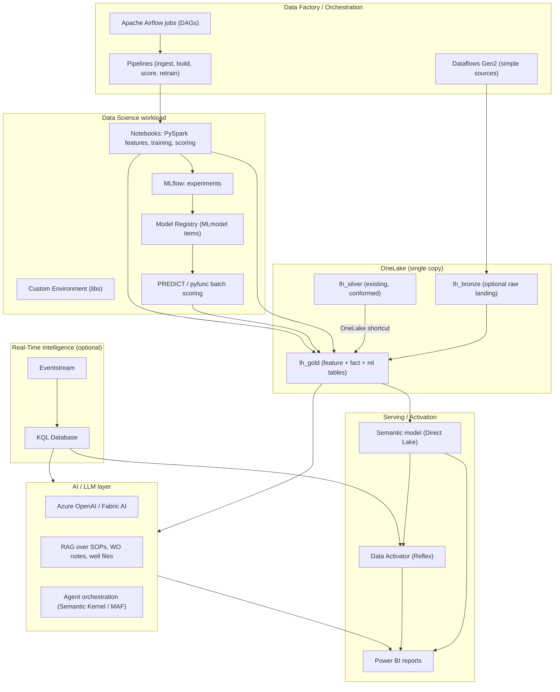

# Deferment Root-Cause & Production Loss Prediction
## Technical ML / AI Engineering Blueprint (Microsoft Fabric)

> Audience: ML engineers, data scientists, data engineers, AI architects.
> No commercial content — this is **how to actually build it**.
> Source of truth: existing `lh_silver` in Fabric. Target outputs: Pareto, trend/pattern detection, early-warning flags, field/flow-station comparison.

---

## 0. TL;DR — the mental model

This use case is **four different problems wearing one name**, and conflating them is the #1 failure mode:

| Output | Real nature | Primary method |
|---|---|---|
| Pareto by cause/field/flow station | **Attribution + counterfactual estimation** | Potential engine + deterministic/learned attribution |
| Trend & recurring-driver detection | **Time-series + sequence mining** | STL/MSTL, changepoints, matrix profile, sequential pattern mining |
| Early-warning flags | **Supervised prediction + anomaly detection** | LightGBM classifier, survival models, unsupervised anomaly |
| Field/flow-station comparison | **Statistical benchmarking** | Production-weighted rates + control charts + significance testing |

The single hardest and most under-estimated piece is **estimating potential (counterfactual) production** — without it, "deferred volume" is undefined and every downstream number is suspect. Treat it as a first-class ML problem, not a given.

**Architecture at a glance:** OneLake shortcuts from `lh_silver` → gold Delta feature/fact tables → Fabric Notebooks (PySpark) for features + MLflow for models → batch scoring into `ml_*` tables → **PREDICT / pyfunc** → Direct Lake semantic model → Power BI + Data Activator. LLM/AI layer adds cause-text normalization, RAG root-cause reasoning, and narrative generation.

---

## 1. Translating the four outputs into formal ML problems

### 1.1 Pareto breakdown → counterfactual + attribution
Not an ML task per se, but it depends on two hard sub-problems:

- **Potential estimation (counterfactual):** what *would* have been produced absent the constraint? `deferred_bbl = ∫ max(0, potential_rate(t) − actual_rate(t)) dt`.
- **Cause attribution:** assigning each event (or each barrel) to a cause — deterministic where codes are clean, **learned/allocated** where events are multi-cause or coded as "unknown".

Engineering the potential engine correctly is what makes the Pareto *defensible* to Business Excellence and JV partners.

### 1.2 Trend & pattern detection → the four sub-problems
1. **Trend/seasonality:** decompose each series (cause, field, station) → STL/MSTL.
2. **Regime shifts:** changepoint detection → PELT / Bayesian online changepoint (BOCPD) / CUSUM.
3. **Recurring motifs:** matrix profile / motif discovery on telemetry + event streams.
4. **Recurring drivers as sequences:** sequential pattern mining over event sequences (e.g., *power dip → ESP trip → deferred*).

### 1.3 Early-warning flags → prediction stack
Three complementary models that vote into one calibrated risk score:
- **(A) Event occurrence classifier** — `P(loss event starts in (t, t+H] | features_t)`.
- **(B) Survival / time-to-failure** — `S(t)` for critical equipment (ESP, compressor, pump).
- **(C) Unsupervised anomaly detection** — precursor detection for unlabeled failure modes.

### 1.4 Field comparison → benchmarking statistics
- Normalize by potential (**deferment %**), not raw volume (avoids size bias).
- Production-weighted aggregation.
- Confidence intervals (bootstrap / beta-binomial) + **control charts (SPC)** for significance.
- Decompose **mix vs. rate** effects (shift-share / Oaxaca-Blinder) to avoid Simpson's paradox.

---

## 2. Reference architecture (Microsoft Fabric)



**Key design decisions**
- **OneLake shortcuts** over `lh_silver` — no data duplication, preserves governance.
- **Gold layer = the ML feature + fact store.** Point-in-time-correct Delta tables used both by models and BI.
- **Lakehouse for ML, Warehouse optional for heavy BI SQL**; expose via **Direct Lake** semantic model for speed.
- **Batch-first**: daily scoring is predictable on F16; add streaming only where lead time demands it.
- **Airflow** for complex DAGs (retraining, backtests); **Pipelines** for simple scheduled jobs.

---

## 3. Data foundation & feature engineering

### 3.1 Grain definitions (get these right first)

| Table | Grain | Purpose |
|---|---|---|
| `fact_deferment_event` | one row per loss event (well or equipment) | target, Pareto, MTTR |
| `fact_production_daily` | well × day | actual vs potential, deferment |
| `fact_equipment_runtime` | equipment × day | run-life, MTBF/MTR features |
| `fact_well_test` | well × test date | rate, GOR, water cut, choke |
| `fact_maintenance` | work order | failure/repair, MTTR, backlog |
| `dim_*` | conformed | well, facility, flow station, field, cause (hierarchical), date |
| `feature_entity_daily` | entity × day (point-in-time) | model training/scoring |
| `ml_deferment_risk` | entity × day × horizon | scores |
| `ml_deferment_forecast` | cause/field × period | forecast |

### 3.2 The potential (counterfactual) engine — the crux

Ranked strategies, blended with uncertainty:

1. **Use existing potential/allowable** if it is trustworthy and methodologically stable over time; version it.
2. **Decline Curve Analysis (Arps)** per well on *clean* (non-deferred) history — robust fit (Huber loss), regime-aware (reset on interventions). Produces a counterfactual baseline with prediction bands.
3. **Counterfactual ML baseline:** train a model on "normal" periods to predict expected rate from well state (choke, GOR, water cut, run hours, pressure) — then `expected − actual` = loss. This is the DS-native approach and handles non-decline wells.
4. **Facility capacity constraint:** for capacity-constrained wells, potential = allocated share of facility capacity.
5. **Ensemble + uncertainty:** combine sources; carry a confidence band; flag low-confidence events for SME review.

> Deliverable: `potential_engine` module that emits `potential_rate`, `potential_bbl`, and `potential_confidence` per well-day. Every downstream metric depends on it.

### 3.3 Label construction for early warning

- **Event occurrence:** label `y=1` if a loss event starts in `(t, t+H]` (H = 24/48/72 h); `y=0` otherwise.
- **Ambiguity handling:** drop or down-weight windows overlapping an active event; apply **gap/embargo** around events.
- **Censoring:** events without a recorded end are **right-censored** → survival framing.
- **Rare events:** class weighting, focal loss, or anomaly-first framing.
- **Multi-horizon:** train H=24/72/168 and expose the horizon the business wants.

### 3.4 Feature families

| Family | Examples |
|---|---|
| **Deferment history** | event count/recency/duration/volume (lagged), cause-share, recurrence interval |
| **Production dynamics** | rate/water-cut/GOR/choke deltas & rolling stats, decline residuals |
| **Equipment health** | ESP run-hours/run-life %, compressor vibration/temp, age since install/overhaul |
| **Maintenance** | WO backlog, overdue PMs, recent repairs, prior failure codes |
| **Operating envelope** | pressure/temperature deviations from envelope, runtime %, trips |
| **Utilities/exogenous** | power availability, gas supply, weather, community/security incidents |
| **Categoricals** | well, field, flow station, completion type, lift type, cause history |
| **Text** | embeds of WO notes / event notes (see §6) |

**Engineering rules:** point-in-time joins only; no future information; consistent timezone/units; **feature registry table** with owner, freshness, and transformation definition.

### 3.5 Leakage controls (non-negotiable)
- **Purged & embargoed walk-forward CV** (López de Prado) for temporal data.
- **Group splits by well** to test generalization to unseen wells.
- Forbid target-derived features from the current event window.
- Freeze feature definitions in the registry; version them with the model.

---

## 4. Modeling per task

### 4.1 Event occurrence (early warning) — primary model
- **Algorithms:** LightGBM / XGBoost (first choice), CatBoost for categoricals; logistic regression baseline.
- **Objective:** binary; handle imbalance with `scale_pos_weight` / focal loss.
- **Calibration:** isotonic or Platt so probabilities are actionable.
- **Uncertainty:** conformal prediction for prediction sets / guaranteed coverage.
- **Explainability:** SHAP (global + per-entity) surfaced in the report.

### 4.2 Deferred volume / duration
- **Volume:** Tweedie or Gamma GLM / gradient boosting regression (zero-inflated, heavy-tailed). Predict per event and aggregate.
- **Forecast:** hierarchical time-series (well → station → field → OML) with reconciliation; LightGBM on lag features, or MSTL/Prophet-style for strong seasonality. Quantile regression for intervals.

### 4.3 Survival / time-to-failure
- **Algorithms:** Cox PH (interpretable baseline), Random Survival Forests, Gradient Boosting Survival; deep survival nets if data-rich.
- **Outputs:** hazard, survival curve, median time-to-next-failure, **remaining useful life** for critical equipment.
- **Censoring-aware** evaluation: concordance index (C-index), time-dependent AUC.

### 4.4 Anomaly detection (precursor / unlabeled)
- **Algorithms:** Isolation Forest, LOF, One-Class SVM, autoencoders (PyTorch), **matrix profile** for telemetry motifs, **BOCPD/CUSUM** for regime change.
- **Use:** novel failure modes, cold-start wells with no labels, sensor drift.
- **Fusion:** blend anomaly score with supervised probability → final risk.

### 4.5 Trend / pattern detection
- **Decomposition:** STL/MSTL per series.
- **Changepoints:** `ruptures` (PELT), BOCPD for online.
- **Motifs/discords:** `stumpy` matrix profile on rate/pressure.
- **Sequences:** PrefixSpan (Spark MLlib) on event-cause sequences.
- **Emerging driver alert:** rolling cause-share change + CUSUM on the mix.

### 4.6 Attribution (multi-cause / unknown)
- **Deterministic** where codes are clean and single-cause.
- **Learned attribution:** multi-label classifier over event features + note embeddings to distribute/assign causes; hierarchical backoff for rare causes.
- **Causal attribution** for root vs. proximate (§5).

### Method-to-output matrix

| Output | Technique | Library |
|---|---|---|
| Pareto | potential engine + attribution | custom + statsmodels |
| Trend | STL/MSTL, changepoint | statsmodels, `ruptures` |
| Patterns | matrix profile, sequence mining | `stumpy`, Spark PrefixSpan |
| Early warning | LightGBM classifier | lightgbm, sklearn |
| RUL | survival analysis | `lifelines`, `scikit-survival` |
| Anomaly | IForest/autoencoder | sklearn, PyOD, PyTorch |
| Comparison | benchmarking + SPC | statsmodels, scipy |
| Forecast | hierarchical TS | lightgbm, `sktime`/`darts` |

---

## 5. Causal root-cause — going beyond Pareto (where "AI expert" adds value)

Pareto tells you *what is biggest*, not *why*. Root-cause claims are causal and observational data is confounded (e.g., high-deferment fields may also be older, so age confounds cause).

- **Build a causal DAG** with SMEs: nodes = equipment age, maintenance backlog, power reliability, operating envelope, cause, deferment.
- **Estimate effects:** **Double ML / EconML** for heterogeneous treatment effects (e.g., effect of preventive-maintenance timing on deferred volume); **DoWhy** for identification + refutation tests.
- **Counterfactual reasoning:** "if we had pulled the PM forward 7 days, what would deferment have been?"
- **Guardrail:** never present correlation as causation without identification assumptions; label outputs as *evidence strength*.

This is what turns "top 3 causes" into **defensible root causes** and supports intervention prioritisation.

---

## 6. AI / LLM layer (beyond classical ML)

This is largely why the platform subscriptions include an LLM (GPT-5.2-chat). High-value, low-risk uses:

| Use | Technique | Value |
|---|---|---|
| **Cause-text normalization** | zero/few-shot LLM classification over event notes → standard taxonomy | Fixes "unknown/other", boosts Pareto coverage |
| **RAG root-cause assistant** | embeddings + vector search over SOPs, WO notes, well files; grounded answer with citations | Engineers query "why did Awoba-12 trip last week?" |
| **Narrative generation** | LLM summarizes Pareto, trends, and alerts in plain language | Exec-ready insights without analyst time |
| **Agentic root-cause reasoning** | orchestrator + specialist agents (detection, retrieval, hypothesis, recommendation) with human approval | Scales triage; naturally leads into Part 3 MAF |
| **Anomaly explanation** | LLM explains SHAP/top drivers in domain language | Trust + adoption |

**Guardrails:** grounding + citations, no numeric invention, human-in-the-loop approval, offline eval of faithfulness, PII/sensitivity handling, prompt/version control.

---

## 7. Evaluation & validation

| Task | Metrics |
|---|---|
| Event classifier | PR-AUC, ROC-AUC, **recall@K**, lift@K, calibration (Brier/ECE), **lead time** |
| Volume/duration | MAE, MAPE, pinball loss (quantiles), bias by segment |
| Survival | C-index, time-dependent AUC, IBS |
| Anomaly | precision@K on flagged alerts, alert-to-event conversion |
| Attribution | agreement with SME labels; % "unknown" resolved |
| Forecast | MAPE / MASE on hold-out, hierarchical coherence |
| Comparison | CI overlap, control-chart breaches |

**Business-weighted evaluation:** `score = Σ(barrels_at_risk × prob × price) − intervention_cost`, evaluated as **lift in top-K alerts**. Report both statistical and operational metrics.

**Backtest harness:** replay history forward, simulate daily alerts, measure precision/lead time/recovered barrels — the artifact that earns trust.

---

## 8. MLOps, orchestration & lifecycle (Fabric-native)

```
Developer push → Git (branch) → PR + CI (lint, unit, data-contract tests)
      → Deployment Pipeline (DEV→TEST→PROD) with Variable Library
      → Scheduled pipelines / Airflow DAG
      → MLflow experiment + Model Registry
      → Batch score (PREDICT/pyfunc) → gold → semantic model → alerts
      → Monitoring (drift, perf, alert precision) → retrain trigger
```

- **CI/CD:** Git integration on workspaces; Azure DevOps/GitHub pipelines call Fabric deployment pipelines; **variable libraries** swap stage parameters.
- **Experiment tracking:** MLflow integrated in Fabric notebooks; register best model as a **Model item** with signature + model card.
- **Batch scoring:** `mlflow.pyfunc` loaded in Spark via `mapInPandas`, or the warehouse **PREDICT** function over registered models.
- **Near-real-time (optional):** deploy the model to an online endpoint (Azure ML) or use Real-Time Intelligence `Eventstream → KQL → Data Activator`; trade-off = complexity/CU vs. seconds-level lead time.
- **Feature store pattern:** Delta **feature tables + a `feature_registry`** with point-in-time correctness (Fabric has no native feature store; this is the pragmatic pattern).
- **Drift monitoring:** PSI/KS on features, prediction-distribution drift, and (with label lag) rolling PR-AUC; alert when thresholds breach.
- **Retraining:** scheduled weekly + drift/perf-triggered; champion/challenger with automatic promotion gates.
- **Testing:** data-contract tests (pandera/Great Expectations), unit tests for transformations, model sanity tests (no leakage, stable outputs), and pipeline integration tests.

---

## 9. Tools & libraries

**Fabric-native**
- OneLake, Lakehouse, Warehouse, Shortcuts, Domains
- Data Factory Pipelines, Dataflows Gen2, Apache Airflow jobs, Variable Libraries, Deployment Pipelines, Git integration
- Notebooks, Spark Job Definitions, Custom Environments
- MLflow, Experiments, Model Registry, PREDICT
- Eventstream, KQL Database, Data Activator (Reflex), Real-Time Hub
- Direct Lake Semantic Models, Power BI, Copilot/Fabric AI, Data Agents
- Capacity Metrics app, Purview (lineage/sensitivity), OneLake security/RLS

**Python / ML**
- Core: numpy, pandas, polars, pyarrow
- Gradient boosting: lightgbm, xgboost, catboost
- Classical ML: scikit-learn, statsmodels
- Time series: sktime, darts, prophet, statsmodels, `ruptures`, `stumpy`
- Survival: lifelines, scikit-survival
- Anomaly: PyOD, PyTorch (autoencoders), alibi-detect
- Causal: dowhy, econml
- Explainability: shap, lime, alibi
- Tuning: optuna, ray[tune]
- Feature engineering: tsfresh, feature-engine
- NLP/LLM: transformers, sentence-transformers, Azure OpenAI SDK, LangChain/Semantic Kernel
- Quality: pandera, great_expectations, pandas-profiling/ydata
- Tracking: mlflow

---

## 10. Compute & performance on F16 (16 CU)

- **Data volume is modest** (~51 datasets) → prefer **single-node / small Spark** and `pandas`/`polars` + LightGBM on the driver for training; reserve distributed Spark for large joins and feature backfills.
- **Spark tuning:** enable autoscale, set min/max nodes, right-size executors, cache only reused feature frames, prefer Delta + predicate pushdown.
- **Stagger schedules** (ingest → gold → score → refresh) to avoid capacity contention; monitor CU via Capacity Metrics.
- **Direct Lake + V-Order** for BI; avoid Import refreshes.
- **Cost control:** batch (not streaming) by default; retrain cadence tuned to event volume; incremental processing where possible.
- **If CU-bound:** move heavy training to **Spark Job Definitions** off-peak, or federated Azure ML compute (with data in OneLake).

---

## 11. Build phases (technical)

| Phase | Core engineering work | Exit criteria |
|---|---|---|
| **F0 Foundations** | Data profiling, contracts, grain definitions, feature registry scaffold | Contracts signed by SMEs; DQ baseline |
| **F1 Potential engine** | DCA + counterfactual ML + capacity blend | Deferred volume reconciled to source within tolerance |
| **F2 Facts & dims** | Gold star schema, point-in-time correctness, DQ tests | Gold builds daily, tests pass |
| **F3 Descriptive** | Pareto, waterfall, benchmarking, SPC | Pareto reconciled & SME-validated |
| **F4 Trends/patterns** | STL/changepoints/matrix profile/sequence mining | Recurring drivers surfaced & explained |
| **F5 Early warning** | Labels, features, LightGBM + survival + anomaly fusion, calibration | Backtest meets PR-AUC/lead-time targets |
| **F6 Causal** | DAG, Double ML, refutation | Root-cause claims with evidence strength |
| **F7 AI layer** | Cause-text normalization, RAG assistant, narratives | Grounded, cited outputs; eval passed |
| **F8 MLOps** | CI/CD, MLflow, scoring, drift monitoring, retrain | Automated lifecycle running in Prod |
| **F9 Hardening** | Security, RLS, capacity tuning, docs, UAT | Signed-off, in managed service |

---

## 12. Risks & edge cases (ML-specific)

| Risk | Technical mitigation |
|---|---|
| **Undefined/bad potential** | Multi-source potential engine + confidence bands; SME review queue |
| **Label leakage** | Purged/embargoed CV; point-in-time joins; feature registry |
| **Rare events / imbalance** | Weighting, focal loss, anomaly-first, hierarchical backoff |
| **Right-censoring** | Survival framing; censor-aware metrics |
| **Cause taxonomy drift** | Versioned taxonomy; LLM re-mapping; monitor "unknown" rate |
| **Cold-start wells** | Hierarchical/pooled models; similarity-based priors |
| **Overlapping/multi-cause events** | Primary-cause rule + attribution model; dedup guardrails |
| **Non-stationarity/concept drift** | Drift monitoring, periodic retrain, champion/challenger |
| **Alert fatigue** | Calibration + top-K gating + business-weighted thresholds |
| **Restated/late data** | Incremental reprocessing, late-arriving handling, versioned snapshots |
| **LLM hallucination** | RAG grounding + citations + human approval + offline faithfulness eval |

---

## 13. Suggested repo / artifact structure

```
deferment-analytics/
├─ src/
│  ├─ data_contracts/        # schemas, expectations
│  ├─ features/              # feature builders, point-in-time joins
│  ├─ potential_engine/      # DCA, counterfactual, capacity blend
│  ├─ attribution/           # deterministic + learned + causal
│  ├─ models/
│  │   ├─ event_classifier.py
│  │   ├─ volume_model.py
│  │   ├─ survival.py
│  │   └─ anomaly.py
│  ├─ evaluation/            # backtest harness, metrics, business score
│  └─ mlops/                 # registry, drift, promotion gates
├─ notebooks/                # exploration + training + scoring
├─ pipelines/                # Fabric pipelines / Airflow DAGs
├─ tests/                    # unit, data-contract, model sanity
├─ ddl/                      # gold table DDL / data dictionary
└─ docs/                     # model cards, feature registry, runbook
```

---

## Bottom line

- **Two hard problems anchor everything:** a rigorous **potential/counterfactual engine** and clean **cause attribution**. Solve those and Pareto becomes trustworthy.
- **Early warning is a small supervised-learning problem with outsized value** — LightGBM + calibration + survival fusion, evaluated as top-K lift and lead time, not raw accuracy.
- **Root cause ≠ Pareto.** Add causal inference (DAG + Double ML) to make "why" defensible.
- **The AI layer** (cause-text normalization, RAG, narratives, agents) is what lifts this from dashboards to a decision system — and feeds directly into Part 3 MAF.
- **Stay Fabric-native** (OneLake shortcuts, Delta gold, Notebooks, MLflow, PREDICT, Direct Lake, Data Activator), batch-first on F16, with real MLOps from day one.

*All table/model names, thresholds, and algorithms are proposals to be validated against the actual `lh_silver` contents in Discovery.*
