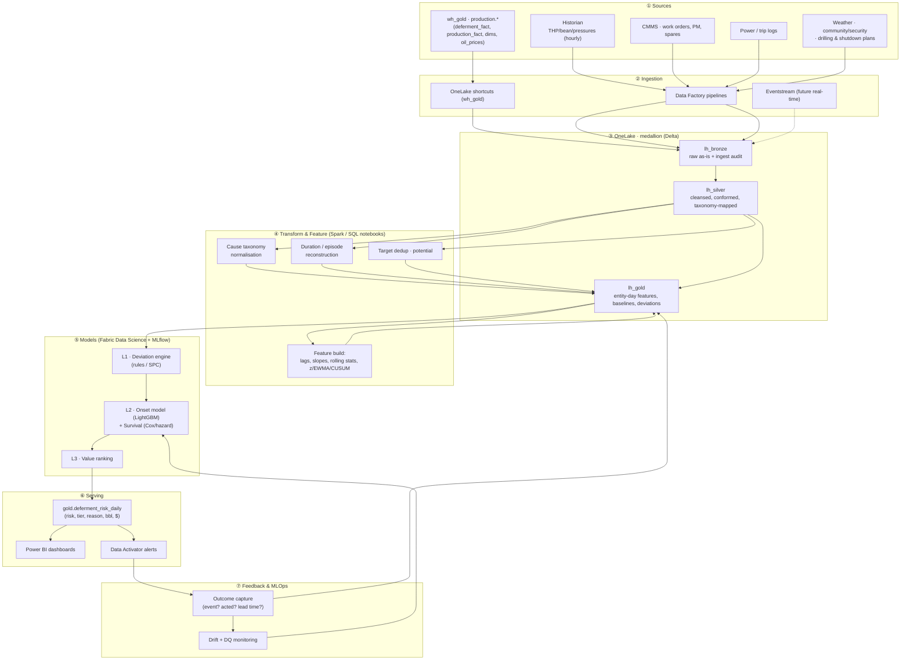
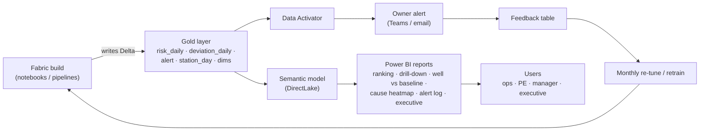

# Early-Warning Architecture — Deferment Risk Detection (end-to-end)

> Project: **Part 1, Project 1 — Deferment Root-Cause & Production Loss Prediction**
> Focus: **"How to detect the risk earlier?"** — flag deferment before it occurs.
> Platform: **Microsoft Fabric** (OneLake · Data Factory · Spark · Data Science · Power BI · Data Activator)
> Status: design proposal (Discovery) · Date: 2026-10-08
> Related: `early-warning-model-design.md`, `early-warning-patterns.md`, `data-quality-findings.md`, `flow-station-early-risk-detection.md`

---

## 1. Purpose & scope

Build a system that, **every day (later: every hour)**, scores each flow station and production string for the **risk of an impending deferment**, explains *why*, ranks it by **money at stake**, and **alerts the owner early enough to act** — then learns from what happened.

**In scope:** ingestion of deferment + production + supporting signals; taxonomy normalisation; per-entity baselines; deviation detection; onset/severity models; risk scoring & tiering; alerting; feedback loop.

**Out of scope (this doc):** root-cause *why* (blocked by the 86% `Mismatch` cause gap — enabling work, not this architecture), supply-chain, forecasting project.

## 2. Requirements driving the architecture

| # | Requirement | Architectural implication |
|---|---|---|
| R1 | Detect risk **earlier** than the deferment log | Entity-day **feature time-series** + per-entity baselines + deviation store are first-class assets |
| R2 | Explainable to operators | Layer-1 deviations carry reason codes; SHAP on Layer-2 |
| R3 | Rank by **money** | `oil_prices` joined at scoring; value = P × bbl × price |
| R4 | Per-station fairness | Baselines & scores computed **per entity**, not fleet-wide |
| R5 | Tolerate messy/partial data | DQ gates + null-tolerant features; never block the daily run on a bad cause code |
| R6 | Read-only on source | Connectors read-only; no writes back to `wh_gold` |
| R7 | Reproducible & auditable | Versioned feature tables + model registry (MLflow) + backtest reports |
| R8 | Feedback | Outcome capture table feeds retraining & threshold tuning |

## 3. Architecture overview

### 3.1 Principles
- **OneLake-first, medallion (bronze → silver → gold).**
- **Batch daily now, streaming later** — same feature contracts, two runtimes.
- **Deterministic before learned** — Layer 1 must work without ML.
- **Entity-day is the atomic grain** (station-day and string-day).
- **Config-as-data** — thresholds, horizons, cause groupings live in tables, not code.

### 3.2 Diagram (Mermaid)



### 3.3 Diagram (terminal-friendly)

```
        ┌────────────────────────────────────────────────────────────────────────┐
 SOURCES│ wh_gold(production.*) │ Historian │ CMMS │ Power │ Weather/Community │ Prices │
        └───────────────┬────────────────────────────────────────────────────────┘
                        │   Data Factory · OneLake shortcuts · Eventstream(future)
                        ▼
 ONELAKE ┌──────────┐   ┌──────────┐   ┌──────────┐
 (Delta) │lh_bronze │──▶│lh_silver │──▶│ lh_gold  │
         │ raw      │   │ cleansed │   │ features │
         └──────────┘   └──────────┘   └────┬─────┘
                                            │
 MODELS  ┌──────────────────────────────────▼───────────────────────────────┐
         │ L1 deviation engine  →  L2 onset model + survival  →  L3 value   │
         └──────────────────────────────────┬───────────────────────────────┘
                                            ▼
 SERVE   ┌──────────────────────────────────────────────────────────────────┐
         │ risk_daily table  →  Power BI dashboards  +  Data Activator alerts│
         └──────────────────────────────┬───────────────────────────────────┘
                                        ▼
 FEEDBACK  outcome capture → drift/DQ monitoring → retrain / re-tune thresholds
```

## 4. Layers & components

| Layer | Component | Responsibility | Fabric item / tool |
|---|---|---|---|
| ① Sources | `wh_gold` | deferment, production, dims, prices | Fabric Warehouse |
| ① Sources | Historian, CMMS, power, weather | **the precursors** not in `wh_gold` | external systems |
| ② Ingestion | Batch copy / shortcut | land raw, add ingest audit | Data Factory pipeline / OneLake shortcut |
| ② Ingestion | Stream (future) | hourly signals | Eventstream → Eventhouse |
| ③ Bronze | `lh_bronze` | immutable raw + `_ingested_at`, `_source` | Lakehouse |
| ③ Silver | `lh_silver` | typed, deduped, taxonomy-mapped, duration, potential | Lakehouse |
| ③ Gold | `lh_gold` | entity-day features, baselines, deviations, risk | Lakehouse |
| ④ Transform | Taxonomy service | map raw drivers → canonical cause hierarchy ≥95% | Notebook / Warehouse SQL |
| ④ Transform | Episode service | reconstruct event runs / duration | Notebook |
| ④ Transform | Potential service | deduped target + potential (versioned method) | Notebook |
| ④ Transform | Feature builder | lags, slopes, rolling stats, z/EWMA/CUSUM | Spark notebook |
| ⑤ Models | L1 deviation engine | per-entity anomaly score + reason | Notebook / SQL, config table |
| ⑤ Models | L2 onset model | P(onset within H) + survival lead time | Fabric Data Science + MLflow |
| ⑤ Models | L3 value ranking | P × bbl × price → priority | Notebook |
| ⑥ Serving | `gold.deferment_risk_daily` | the product: risk, tier, reason, $ | Lakehouse table |
| ⑥ Serving | Dashboards | station ranking, drill-through, heatmap | Power BI |
| ⑥ Serving | Alerts | Red/Amber → owner | Data Activator → Teams/email |
| ⑦ Feedback | Outcome capture | event happened? acted? lead time? | Lakehouse table + form |
| ⑦ Feedback | Monitoring | drift, DQ, alert precision | Notebook + Power BI |

## 5. Data contracts by layer

| Table | Grain | Key columns | Refresh |
|---|---|---|---|
| `silver.deferment_event` | event | event_id, station_id, string, date, cause_group, cause_code, deferred_oil, duration_days, is_coded | daily |
| `silver.production_day` | string-day | station_id, string, date, oil, target_oil(deduped), potential, uptime_hrs, thp, bean, water_rf | daily |
| `silver.station_day` | station-day | station_id, date, actual_oil, target_oil, deferred_oil, events, deferment_pct | daily |
| `gold.entity_day_features` | station-day **and** string-day | all `silver` measures + lag_1..14, slope_3/7/14, rolling_mean/std, z, ewma, cusum per signal | daily |
| `gold.entity_baseline` | entity × signal | median, MAD, seasonal profile, valid_from/to | monthly |
| `gold.onset_labels` | entity × cause_group × date | onset_in_1/3/7 (training only) | daily |
| `gold.deferment_risk_daily` | station-day (+ string drill) | risk_prob, tier, top_reasons[], exp_bbl, exp_usd, model_version | daily |
| `feedback.outcomes` | alert | alert_id, fired_at, event_occurred, acted, actual_lead_days | on event |

## 6. End-to-end flow (the daily run)

1. **Ingest** — shortcut/copy `wh_gold` tables + any external feeds into `lh_bronze`; stamp `_ingested_at`.
2. **Validate (gate)** — row counts, date coverage, FK integrity, cause-code completeness. **Warn, don't block**; record DQ score.
3. **Conform** — type/cast; map raw drivers → canonical cause hierarchy; dedupe `target_oil` (station-day `max`); compute `potential = actual + deferred` (versioned).
4. **Episode** — reconstruct event runs; derive duration where possible; mark coded vs uncoded.
5. **Feature** — build entity-day table; compute lags, slopes, rolling volatility, and per-signal **z / EWMA / CUSUM** against each entity's own baseline.
6. **Score** —
   - **L1**: deviation engine → anomaly score + reason codes (always runs).
   - **L2**: onset model → P(onset within H) + survival lead time (when available).
   - **L3**: value = P × expected bbl × oil price → priority.
7. **Tier & route** — Red/Amber/Green; Red/Amber push to owner via Data Activator; all states in Power BI.
8. **Publish** — write `gold.deferment_risk_daily`; refresh dashboards.
9. **Feedback** — capture whether the event occurred and whether the team acted; compute realised lead time & false alarms.
10. **Learn** — monthly: re-fit baselines, re-tune thresholds, retrain L2, backtest, promote model if it beats incumbent on lead time at fixed alert budget.

**Future real-time variant:** steps 1–5 run hourly for historian signals (Eventstream → Eventhouse); steps 6–7 run on a sliding window; same gold contracts.

## 7. Modelling services (detail)
See `early-warning-model-design.md`. Summary: **L1** per-entity deviation (z/EWMA/CUSUM + change-point) → **L2** LightGBM onset classifier + Cox/discrete-hazard survival → **L3** value ranking. Evaluation = chronological backtest, **median lead time** + PR-AUC + false-alarm rate.

## 8. Serving, reporting & alert routing

### 8.1 Consumption path

The findings are written as **Delta tables** to the gold layer, modelled by a **semantic model**, and consumed through **Power BI** and **Data Activator**.



### 8.2 How findings are loaded and surfaced
1. The build writes the output tables as Delta into the gold lakehouse/warehouse (`risk_daily`, `deviation_daily`, `alert`, `station_day`, dimensions).
2. A **semantic model** is created over those tables using **DirectLake** (no copy, near-instant), with Import fallback.
3. **Power BI report pages:** ranked stations by value at risk; station drill-down; well detail with trend versus its own baseline; cause heatmap; alert log and precision; executive summary.
4. **Measures:** count and value of risks, median lead time, alert precision, false alarms per station per week, coverage.
5. **Data Activator** raises Red/Amber alerts to the mapped owner; repeat alerts suppressed.
6. Published as an **app**; **row-level security** by asset where required; **refresh** follows the daily build (DirectLake auto, else scheduled).

### 8.3 Alert content
Message = *which station/well, likely cause group, how soon, barrels and value at risk, what to check, owner*. Rate-limited to an operator-absorbable budget.

### 8.4 Owner map
Station → responsible engineer; HSE / third-party causes → respective owner.

### 8.5 Related output tables
See PRD §12.5 for the star-schema definition of `risk_daily`, `deviation_daily`, `alert`, `station_day` and the dimensions.

## 9. Feedback & MLOps
- Outcome table keyed to each alert; realised **lead time** and **hit/miss**.
- Drift monitoring on features & residuals; DQ dashboard.
- MLflow registry: model version, metrics, data window; promotion gate vs incumbent.
- Retrain monthly (or on drift); baselines refreshed more often.

## 10. Security & governance
- **Source access read-only** (workspace `Viewer` / `db_datareader`; `ApplicationIntent=ReadOnly`). No writes to source. (See `how-to-give-agent-data-access.md`.)
- **RBAC:** separate roles for ingesters, modellers, consumers; least privilege.
- **Data residency:** NewCross data stays in the NewCross tenant; nothing exfiltrated to Wragby.
- **Purview / sensitivity labels** on gold outputs; row-level security per asset if required.
- **No secrets in code** — Key Vault / Fabric connections; `.env` only for local dev (git-ignored).
- **Auditability:** every query/run logged; model card per version.

## 11. Observability & DQ gates
- Freshness/volume checks per table; schema-drift alerts.
- Cause-code completeness tracked as a first-class metric (currently **86% `Mismatch`** — a gate on cause-specific models, not on L1).
- Alert telemetry: alerts/day, precision, override rate.

## 12. Environments & deployment
- **Dev (current):** local Python + `tools/fabric_query.py` (read-only) + `duckdb` over `data/` CSVs → prototype the feature/deviation logic fast.
- **Test/Prod:** Fabric workspace(s); Data Factory + notebooks; CI promotes notebook/definition artifacts; separate lakehouses per env.
- **Config-as-data:** thresholds/horizons/cause-groups in tables so tuning needs no redeploy.

## 13. Tooling — current vs target

| Concern | Current (prototype, now) | Target (Fabric, production) |
|---|---|---|
| Source read | `tools/fabric_query.py` (mssql-python, read-only) | OneLake shortcut / Data Factory |
| Storage | `data/*.csv` (git-ignored) | `lh_bronze/silver/gold` (Delta) |
| Compute | `duckdb` + Python locally | Spark notebooks / Warehouse SQL |
| Models | Python (planned) | Fabric Data Science + MLflow |
| Serving | Markdown findings | Power BI + Data Activator |
| Docs | this repo (`*.md`) | repo + Fabric workspace |

## 14. Non-functional requirements
- **Latency:** daily batch completes in the off-peak window; real-time < 1 h later.
- **Freshness:** T+1 daily (target T+1 hour in future).
- **Scale:** 5 stations, 71 strings today → design for multi-asset (OML 147/152 already present).
- **Capacity:** bounded queries/extracts; prefer OneLake reads to engine reads; schedule off-peak (F16 shared).
- **Explainability:** every alert carries reasons; no black-box-only alerts.
- **Resilience:** a failed feed degrades gracefully (partial features, explicit "insufficient data" state).

## 15. Open decisions
1. **Scope:** OML 24 only, or OML 147/152 too?
2. **Cause taxonomy fix** owner & timeline (gates L2 cause-specific models).
3. **Historian availability/frequency** — determines whether real-time is feasible.
4. **Horizons H** (1/3/7 d) — set after measuring L1 lead time.
5. **Alert budget** per station/week (drives thresholds).
6. **Read-only identity** for ongoing access (vs the current admin account).

## 16. Roadmap mapping
1. **Phase 0 (now):** prototype feature + **L1 deviation engine** locally; produce **measured lead-time table**.
2. **Phase 1:** Fabric pipeline bronze→silver→gold; L1 running in Fabric; Power BI station view.
3. **Phase 2:** L3 value ranking + Data Activator alerts.
4. **Phase 3:** L2 onset + survival model; feedback loop.
5. **Phase 4:** real-time historian stream.

---

*Design proposal, 2026-10-08 — components, contracts and thresholds to be confirmed during Discovery.*
