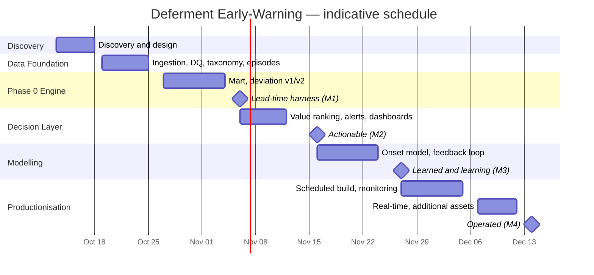

# The Fabric Build — End to End (Complete Reference)

> Deferment Early-Warning Solution · Advanced Analytics & AI (Part 1, Project 1)
> Client: NewCross Exploration & Production (OML 24) · Platform: Microsoft Fabric
> Purpose: explain, in plain English, **how this solution is built in Microsoft Fabric from the very beginning to the very end** — every stage, every tool, and every design rule — so nothing is left out.
> Status: consolidated reference · Version 1.0 · 2026-10-14
> Audience: business, operations, engineering and new joiners. No prior reading required.

This document consolidates and supersedes the build narrative spread across `end-to-end-in-plain-language.md`, `pipeline-in-plain-language.md`, `technology-stack-and-fabric-implementation.md`, `how-fabric-delivers-results.md`, `early-warning-architecture.md`, `early-warning-model-design.md`, `alert-log-and-feedback-loop.md`, `automation-and-human-in-the-loop.md`, `prd-deferment-early-warning.md`, `wbs-deferment-early-warning.md`, `data-quality-findings.md`, `early-warning-patterns.md`, `model-framing-time-series-vs-forecasting.md` and `decisions-log.md`. Where those documents differ in detail, this document keeps all of the detail.

---

## Table of contents

1. [The one-sentence picture](#1-the-one-sentence-picture)
2. [The problem we are solving](#2-the-problem-we-are-solving)
3. [The three facts from the real data that shape everything](#3-the-three-facts-from-the-real-data-that-shape-everything)
4. [What we are building — and what we are not](#4-what-we-are-building--and-what-we-are-not)
5. [Model framing: time series data, event prediction (not forecasting)](#5-model-framing-time-series-data-event-prediction-not-forecasting)
6. [The layered design (L1 → L2 → L3)](#6-the-layered-design-l1--l2--l3)
7. [Prerequisites before the build starts](#7-prerequisites-before-the-build-starts)
8. [The whole platform at a glance (full tool map)](#8-the-whole-platform-at-a-glance-full-tool-map)
9. [The end-to-end build, stage by stage](#9-the-end-to-end-build-stage-by-stage)
   - [Stage 0 — Discovery & design](#stage-0--discovery--design-before-any-platform-tool)
   - [Stage 1 — The foundation (capacity, workspaces, OneLake, lakehouses)](#stage-1--the-foundation-capacity-workspaces-onelake-lakehouses)
   - [Stage 2 — Ingestion → bronze](#stage-2--ingestion--bronze)
   - [Stage 3 — Cleaning & conforming → silver](#stage-3--cleaning--conforming--silver)
   - [Stage 4 — Features, baselines & labels → gold](#stage-4--features-baselines--labels--gold)
   - [Stage 5 — Model training (Data Science + MLflow)](#stage-5--model-training-data-science--mlflow)
   - [Stage 6 — Model registry & governance](#stage-6--model-registry--governance)
   - [Stage 7 — Batch scoring](#stage-7--batch-scoring)
   - [Stage 8 — Orchestration](#stage-8--orchestration)
   - [Stage 9 — Serving (semantic model, Direct Lake)](#stage-9--serving-semantic-model-direct-lake)
   - [Stage 10 — Reporting (Power BI report, app, RLS, AI narrative)](#stage-10--reporting-power-bi-report-app-rls-ai-narrative)
   - [Stage 11 — Alerting (Data Activator)](#stage-11--alerting-data-activator)
   - [Stage 12 — Feedback capture (the write-back)](#stage-12--feedback-capture-the-write-back)
   - [Stage 13 — The learning loop (monthly re-tune & retrain)](#stage-13--the-learning-loop-monthly-re-tune--retrain)
   - [Stage 14 — Real-time later (Eventstream + Eventhouse)](#stage-14--real-time-later-eventstream--eventhouse)
10. [The output tables in full (the star schema)](#10-the-output-tables-in-full-the-star-schema)
11. [The alert lifecycle and the three capture arms](#11-the-alert-lifecycle-and-the-three-capture-arms)
12. [Automation vs human-in-the-loop (task by task)](#12-automation-vs-human-in-the-loop-task-by-task)
13. [Governance, security and compliance](#13-governance-security-and-compliance)
14. [Environments, CI/CD and deployment](#14-environments-cicd-and-deployment)
15. [Monitoring, data-quality gates and observability](#15-monitoring-data-quality-gates-and-observability)
16. [Capacity and cost](#16-capacity-and-cost)
17. [The phase roadmap and milestones](#17-the-phase-roadmap-and-milestones)
18. [Deliverables, KPIs and success metrics](#18-deliverables-kpis-and-success-metrics)
19. [Data-quality constraints and how the design tolerates them](#19-data-quality-constraints-and-how-the-design-tolerates-them)
20. [Per-station coverage and readiness](#20-per-station-coverage-and-readiness)
21. [Personas — who sees what](#21-personas--who-sees-what)
22. [The journey of one number (worked example)](#22-the-journey-of-one-number-worked-example)
23. [Rules that never change (guardrails)](#23-rules-that-never-change-guardrails)
24. [Open decisions still to confirm](#24-open-decisions-still-to-confirm)
25. [Glossary of platform terms](#25-glossary-of-platform-terms)
26. [Source documents and traceability](#26-source-documents-and-traceability)

---

## 1. The one-sentence picture

We take about **two years of the plant's daily production history**, learn what "normal" looks like for **each flow station**, watch the physical signals for a slow drift away from that normal, learn what the days *before* a loss usually look like, then every morning produce a **ranked to-do list of which flow stations are about to lose oil, why, and how much money is at stake** — pushed to the right engineer before the barrels are gone.

Think of it like a **smoke alarm for lost production** instead of a fire report written after the fire.

**Where Fabric fits:** Microsoft Fabric is the **entire factory** — ingestion, storage, transformation, machine learning, serving and alerting all live on one platform, over **one copy of the data**, under **one security model**, on **one capacity**, for **one bill**. The business only ever touches the two visible ends of it: a **Power BI report** and a **Teams/email alert**.

---

## 2. The problem we are solving

When oil is "deferred" (lost production because a well, flowline or facility is down), it shows up in a log or a monthly report **after** it happened. The business learns from the rear-view mirror. By the time anyone sees *"Well 12 deferred 1,200 barrels,"* the barrels are already gone.

**The goal** is *not* to predict *that* deferment will happen (deferment happens somewhere almost every day, so predicting "yes" would nearly always be right and completely useless). The goal is to catch **the start of a new problem at a specific flow station, days before it is recorded**, and to tell someone in time to act.

**In scope of this build (Part 1, Project 1):**
- Ingestion of deferment + production + supporting signals.
- Cause-taxonomy normalisation.
- Per-entity baselines.
- Deviation detection.
- Onset/severity models.
- Risk scoring and tiering.
- Alerting.
- The feedback loop.

**Out of scope:** root-cause *why* (blocked by the 86% `Mismatch` cause gap — treated as enabling work, not this architecture); supply-chain analytics; production forecasting; report redesign; multi-agent automation (separate workstreams); any write-back to source systems; procurement of third-party systems.

---

## 3. The three facts from the real data that shape everything

Three findings from the live `wh_gold` data (24 months, 2024-10-01 → 2026-10-07) drive every design decision below.

**Fact 1 — Deferment is present on ~95% of station-days.** Every station has a logged event on 675–709 of 737 days:

| Station | Days with ≥1 event (of 737) |
|---|---:|
| OML 147 | 709 |
| Ekulama 2 | 700 |
| Ekulama 1 | 700 |
| Awoba | 697 |
| EFE | 675 |

So "will there be a deferment?" is trivially "yes". Early warning must target the **onset** of a specific failure episode, a **severity** spike (a day far above that station's own normal), or a **regime shift** (the station's loss level changing/worsening).

**Fact 2 — Loss is highly persistent ("today looks like yesterday").** Lag-1 autocorrelation of daily deferred oil per station:

| Station | lag-1 corr | Reading |
|---|---:|---|
| OML 147 | **0.82** | Chronic condition; yesterday almost perfectly predicts today |
| Ekulama 2 | **0.79** | Chronic |
| EFE | 0.54 | More volatile |
| Ekulama 1 | 0.52 | Volatile |
| Awoba | 0.45 | Most volatile/spiky |

A model that simply uses "yesterday's loss" looks accurate **but warns too late** — it fires only after the loss has started. The value is in detecting the **change**.

**Fact 3 — For many causes the physical signal leads the log by a week or more.** Wellhead pressure (THP) and uptime collapse about a week before a "Well No-Flow" entry appears. The physical signal is the early warning; the log lags it. That gap is exactly where early warning lives.

---

## 4. What we are building — and what we are not

**The solution:** a system that, every day (later: every hour), scores each flow station and production string for the **risk of an impending deferment**, explains *why*, ranks it by **money at stake**, and **alerts the owner early enough to act** — then learns from what happened.

**The output is not a single yes/no flag.** It is a **rich, explainable record** — probability, tier, reason(s), barrels and dollars at risk — from which a simple alert is derived.

**The approach is layered, so value is delivered before the most advanced parts exist:**
1. **Baseline & deviation engine** — learn what is "normal" for each station/string and detect when a signal departs from it.
2. **Lead-time measurement** — prove how many days early a flag fires, at an acceptable false-alarm rate.
3. **Value ranking & alerting** — turn scores into ranked, money-aware warnings routed to the right person.
4. **Predictive modelling** — a learned onset model, added only if it measurably warns earlier than the deviation engine.
5. **Feedback loop** — capture whether alerts were right and acted on, and tune continuously.

**The data spans** ~two years of daily deferment events, production actuals and targets, wellhead/process signals (pressure, choke, water cut, uptime), flow-station/reservoir reference data, and oil prices across three assets.

---

## 5. Model framing: time series data, event prediction (not forecasting)

**The question everyone asks:** *"Is this a time-series solution? Should we use ARIMA / Prophet / LSTM to forecast deferment?"*

**Short answer:** the **data** is genuinely time series. The **solution is not a classic time-series forecasting model** — it is an **early-warning system** delivered mainly as **event prediction + anomaly and survival analysis**, with only a small **forecasting** element (the value at risk). In one line: **a leading-indicator solution built on time-series data — event prediction, not value forecasting.**

| Dimension | Typical forecasting model | This solution |
|---|---|---|
| Target | The next value of a series (a number) | Whether an **event starts** (a class) |
| Question answered | "How much, next period?" | "Will trouble start soon — and how soon?" |
| Data shape | One (or few) series | Many entities (station × well), aggregated to entity-day |
| Headline metric | Forecast error (MAE / RMSE / MAPE) | **Lead time** (days of warning), precision/recall |
| Why it works | The series varies enough to forecast | The value is in the **change**, before the loss is logged |
| Base-rate problem | Not usually an issue | Loss occurs on ~95% of station-days, so forecasting occurrence is accurate but useless |

**Component-by-component classification:**

| Component | Task | Flavour |
|---|---|---|
| Deviation engine | Anomaly / change-point detection per signal | Time series |
| Onset model | "Event within the next 1 / 3 / 7 days?" from lagged clues | Time series turned into **classification** |
| Survival model | Time to onset | Time series / **survival analysis** |
| Expected loss | Barrels and value at risk | **Forecasting** (the only forecasting piece) |

**Why not ARIMA / Prophet / deep sequence models:** ARIMA/Prophet forecast a series' next values — but here the series is almost always "loss happening" (~95% of days), so forecasting it is accurate but uninformative and fires *after* the loss starts. Deep sequence models (LSTM/Transformer) need far more data and higher frequency than 5 stations × ~2 years of daily history, and cannot explain *why* a flag fired. Tabular models on engineered temporal clues (lags, rolling windows, deviations) win at this scale.

**How a real forecasting model would compose (complementary, not the same thing):**
> `expected loss = P(onset within H) × forecast volume at risk × price`

Our solution supplies the probability; a forecasting model could supply the volume. The current build uses a simple proxy (recent loss rate) for the volume term and can be upgraded later.

**Implications for build and judging:** respect time order everywhere (lags, rolling windows, chronological splits, no shuffling); temporal feature engineering is where the time lives; use time-aware cross-validation (rolling windows), not random k-fold; judge by lead time, not forecast error; monitor drift and retrain periodically.

---

## 6. The layered design (L1 → L2 → L3)

The system is **three layers**, because no single model fits the constraints (95% base rate, persistent loss, 86% unusable cause codes, no duration labels, partial precursors).

### Layer 1 — Per-entity deviation engine (baseline, always on)
- Learn **each station's and each string's own normal** for `uptimeproduction`, `thp`, `bean`, `water_rf`, oil-vs-deduplicated-target, and event frequency.
- Robust, seasonal baseline (median + MAD; day-of-week / month-of-year).
- Deviation detectors: **z-score**, **EWMA**, **CUSUM** (CUSUM/EWMA catch slow drifts days earlier than raw thresholds), plus **change-point detection** for a station regime shift.
- Output: an anomaly score **plus which signal moved** — explainable by construction.
- This layer needs **no machine learning at all** — it is transparent rules and always runs. It alone can fire warnings (rule-based tiers) and is the honest MVP.

### Layer 2 — Supervised onset model (learned)
- **Algorithm: gradient-boosted trees (LightGBM / XGBoost)** — tabular, handles missingness, works on small data, fast, explainable via SHAP. This is the primary "prediction model".
- **Features:** Layer-1 deviations + lags (1–14 days), rolling deltas/velocity, rolling volatility, uptime/THP/bean/water-cut levels and slopes, recent event history & gaps, oil-vs-target gap, station/string/asset identifiers.
- **Target:** onset-in-H (see labels below).
- **Companion: survival model** (`Cox PH` or discrete-time hazard) for **time-to-onset**, yielding the lead-time distribution directly.
- **Start rule-first, learn second:** ship Layer 1, then train Layer 2 and keep it only if it beats Layer 1 on lead time / false alarms.

### Layer 3 — Value ranking (priority)
- `Risk = P(onset within H) × expected bbl at risk × oil price`.
- Expected bbl from the magnitude model or recent loss run-rate.
- Output → **Red / Amber / Green**, ranked by money, routed to the owner.
- Requires `oil_prices` (a tiny table, not yet pulled) for the money term.

### The labels we actually predict

| Label | Definition | Used for |
|---|---|---|
| **Onset-in-H (primary)** | For entity = station **or** string, cause *c*: `y=1` if the **first day of a coded-cause episode** falls within the next H days (H ∈ {1, 3, 7}); else 0. Episode = run of consecutive days carrying *c*. | Supervised onset model |
| **Severity-onset (fallback)** | Station-day deferred oil ≥ its **own 90th percentile**, following ≥K quiet days. | When cause codes are unusable |
| **Next-day loss (magnitude)** | Continuous deferred-oil volume per station-day. | Value/priority ranking |

**Cause grouping (to beat sparsity):** equipment/rotating, facility/utilities, well/subsurface, flowline/export, planned. Model each group, then drill in.

### Why not deep learning yet
5 stations, 71 strings, ~5,400 coded events, daily granularity, and a cause-code gap. Deep nets need far more data and higher frequency, and operators need *reasons*. Revisit when we have **hourly historian feeds** and clean cause codes. GBM + survival is the right ceiling for now. *(Decision D-04, `decisions-log.md`.)*

### How we judge it (the "earlier" proof)
Evaluation must be a **chronological backtest**, never a random split. Metrics:
- **Median lead time (days)** — how early before onset the flag fires. **The headline KPI.**
- **Recall at a fixed alert budget** (alerts/day an operator can absorb) — precision/recall on a rare positive class; use **PR-AUC**, not accuracy.
- **False-alarm rate** per station per week.
- **Stability** across stations (one model, per-station behaviour).

The KPI sentence we are aiming to earn: *"For cause group G at station S, the model flags N days before onset with F false alarms/week."*

---

## 7. Prerequisites before the build starts

### 7.1 Discovery (no platform tool)
Workshops with operations, data/process owners and report owners to confirm:
- Requirements and the Business Requirements Document (BRD).
- **Value definition** — KPI baseline and targets (lead time, false-alarm rate, coverage).
- **Cause-taxonomy gap analysis** — a gap report with a named fix owner.
- **Solution architecture and data contracts**, signed off.

### 7.2 What NewCross must provide

1. A **Fabric capacity** (the proposal sizes this at **F16**) and a **workspace**, plus separate **Dev / Test / Prod** workspaces for a clean promotion path.
2. A **read-only identity** (service principal or least-privilege account) for ongoing source access, replacing the current admin account (`sharepoint.admin@Newcross.com`).
3. **Source access** to the warehouse tables and, later, historian/CMMS feeds.
4. A **gateway** only if a source sits outside the Fabric network.
5. **Teams** for alert delivery and **Entra groups** for report access and row-level security.
6. **Workspace admin** rights for the delivery team, and **Key Vault** (or Fabric connections) for secrets.
7. Confirmation of **scope** (which assets/stations are in scope) for security design.

### 7.3 Data we have vs data we need

- **Have (in `wh_gold`, schema `production`, 24 months):** `deferment_fact`, `production_fact`, `flowstations_dim`, `deferment_category_dim`, `deferment_subcategory_dim`, plus `oil_prices` (tiny).
- **Need (external feeds, later):** historian (hourly THP/bean/pressure), CMMS/work orders, power/trip logs, weather, community/security, drilling/shutdown plans.
- **Blocker:** cause-code quality (86% `Mismatch`) gates cause-**specific** modelling.
- **Dependency:** a read-only identity in the NewCross tenant.

### 7.4 The prototype foundation (Phase 0, before Fabric productionisation)
The current local prototype is used to prove the logic before it is moved into Fabric:
- **`tools/fabric_query.py`** — a small, strictly **read-only** connector (mssql-python) pulling `wh_gold` tables as CSV. It refuses any non-`SELECT` statement and logs every query to `logs/fabric_queries.log`.
- **Local CSVs** in `data/` (git-ignored).
- **`duckdb` + Python** locally for fast feature/deviation prototyping.
- **Markdown findings** as the interim serving surface.

---

## 8. The whole platform at a glance (full tool map)

One sentence: **Microsoft Fabric is the entire factory.**

| Concern | What we use | Fabric item / workload |
|---|---|---|
| Source systems | Field production DB, deferment log, reference tables | external (warehouse in the tenant) |
| Ingestion | Scheduled copy / shortcuts, read-only | **OneLake shortcuts** + **Data Factory** pipelines |
| Raw storage | Faithful copy of what arrived | **Lakehouse** `lh_bronze` (Delta in OneLake) |
| Cleaning & conforming | Standardise, de-duplicate, taxonomy, episodes | **Spark notebooks** (Data Engineering) → `lh_silver` |
| Features & baselines | Entity-day clues, per-entity normal, deviations | **Spark/SQL notebooks** → `lh_gold` |
| Model training | Gradient-boosted trees + survival companion | **Fabric Data Science** notebook + **MLflow** |
| Model registry | Versioned models, metrics, promotion gate | **MLflow** (workspace model registry) |
| Batch scoring | Daily risk per station/well | **Spark/Python notebook**, scheduled |
| Orchestration | Run order, schedule, retries, failure alerts | **Data Factory** pipelines (or **Airflow** job) |
| Serving model | Governed business logic, measures, drill-down | **Power BI semantic model** over gold (Direct Lake) |
| Reports | Persona pages + app | **Power BI** report + **Power BI app** |
| Alerts | Rule + routing + delivery | **Data Activator** (Reflex) → Teams / email |
| Feedback capture | One-click acknowledgement + write-back | **Power Automate** / Teams cards / **Power Apps** (or Fabric User Data Functions) |
| Real-time (later) | Hourly historian signals | **Eventstream** + **Eventhouse** (Real-Time Intelligence) |
| Governance | Access, labels, lineage | Workspaces, **RBAC**, **Purview**, sensitivity labels |
| Secrets | Connections and keys | **Key Vault** / Fabric connections |
| CI/CD | Promote definitions across environments | **Git integration** + **Deployment pipelines** |
| Monitoring | Freshness, volume, drift, DQ | Monitoring hub + notebook checks + Power BI |

**Alternative stacks we are deliberately not choosing.** The same solution could be assembled from Azure Data Factory + ADLS + Databricks + Azure ML + Power BI. It would work, but would mean several platforms, several security models and several bills. Because the client **already owns Fabric**, the native build removes integration overhead and keeps the data in one governed place. (Azure ML remains a valid fallback only if the ML team standardises on it; it is not preferred here.)

---

## 9. The end-to-end build, stage by stage

The diagram below is the spine of everything that follows.

```
  SOURCE (tenant)                 ONE LAKE  (OneLake, Delta)
  ┌───────────────┐   shortcut    ┌──────────────────────────────────────────┐
  │ production DB │──────────────▶│  lh_bronze   raw + ingest audit          │
  │ deferment log │   / Data      │      │  notebooks: clean / taxonomy /     │
  │ reference     │   Factory     │      ▼            episodes               │
  └───────────────┘   copy        │  lh_silver   cleansed, conformed         │
                                  │      │  notebooks: features + baselines  │
                                  │      ▼                                    │
                                  │  lh_gold     entity-day features,         │
                                  │              deviations, risk, alerts     │
                                  └───────┬───────────────────────┬──────────┘
                                          │                       │
                            Direct Lake   │                       │  Data Activator
                                          ▼                       ▼
                                 Power BI semantic model     Teams / email alert
                                          │                       │
                                          ▼                       ▼
                                   Power BI report/app      one-click outcome
                                                           → write-back to lh_gold
```

Terminal-friendly view of the same flow:

```
        ┌────────────────────────────────────────────────────────────────────────┐
 SOURCES│ wh_gold(production.*) │ Historian │ CMMS │ Power │ Weather/Community │ Prices │
        └───────────────┬────────────────────────────────────────────────────────┘
                        │   Data Factory · OneLake shortcuts · Eventstream(future)
                        ▼
 ONELAKE ┌──────────┐   ┌──────────┐   ┌──────────┐
 (Delta) │lh_bronze │──▶│lh_silver │──▶│ lh_gold  │
         │ raw      │   │ cleansed │   │ features │
         └──────────┘   └──────────┘   └────┬─────┘
                                            │
 MODELS  ┌──────────────────────────────────▼───────────────────────────────┐
         │ L1 deviation engine  →  L2 onset model + survival  →  L3 value   │
         └──────────────────────────────────┬───────────────────────────────┘
                                            ▼
 SERVE   ┌──────────────────────────────────────────────────────────────────┐
         │ risk_daily table  →  Power BI dashboards  +  Data Activator alerts│
         └──────────────────────────────┬───────────────────────────────────┘
                                        ▼
 FEEDBACK  outcome capture → drift/DQ monitoring → retrain / re-tune thresholds
```

**The ten steps of the daily run (summary):**
1. **Ingest** — shortcut/copy `wh_gold` tables + external feeds into `lh_bronze`; stamp `_ingested_at`.
2. **Validate (gate)** — row counts, date coverage, FK integrity, cause-code completeness. **Warn, don't block**; record a DQ score.
3. **Conform** — type/cast; map raw drivers → canonical cause hierarchy; de-duplicate `target_oil` (station-day `max`); compute `potential = actual + deferred` (versioned).
4. **Episode** — reconstruct event runs; derive duration where possible; mark coded vs uncoded.
5. **Feature** — build the entity-day table; compute lags, slopes, rolling volatility, and per-signal **z / EWMA / CUSUM** against each entity's own baseline.
6. **Score** — L1 deviation → L2 onset + survival → L3 value.
7. **Tier & route** — Red/Amber/Green; Red/Amber push to owner via Data Activator; all states in Power BI.
8. **Publish** — write `gold.deferment_risk_daily`; refresh dashboards.
9. **Feedback** — capture whether the event occurred and whether the team acted; compute realised lead time & false alarms.
10. **Learn** — monthly: re-fit baselines, re-tune thresholds, retrain L2, backtest, promote if it beats the incumbent.

Each stage is detailed below.

---

### Stage 0 — Discovery & design (before any platform tool)

**What happens:** requirements, value/KPI definition, cause-taxonomy gap analysis, and an approved architecture with data contracts. Slice the work into **vertical slices** (Decision D-11) — each work item delivers a thin end-to-end increment (data → feature → score → surface), independently demoable. No slice delivers only a layer.

**Tools:** none in Fabric yet. Deliverables are the BRD, KPI baseline, gap report, architecture and data contracts.

---

### Stage 1 — The foundation (capacity, workspaces, OneLake, lakehouses)

**What happens:** the client's Fabric capacity and workspaces are prepared, and the three medallion lakehouses are created. This is the "empty kitchen and pantry" step.

#### 🔧 Fabric Capacity (F16)
- **What it is:** The compute + storage entitlement that powers everything in a Fabric tenant — the engine size of the whole workspace. F16 is a mid-size engine.
- **How it is normally used:** You buy a capacity; everything in the tenant (pipelines, notebooks, ML, Power BI) draws on it.
- **What we use it for:** **One F16 capacity powers storage, Spark, ML and BI together.** This is the "one bill, one engine" advantage. Heavy work is scheduled off-peak so it does not compete with daytime BI.

#### 🔧 Fabric Workspace (Dev / Test / Prod)
- **What it is:** A container that holds all the items for one environment (lakehouses, notebooks, pipelines, semantic models, reports).
- **How it is normally used:** Teams organise work into workspaces; access is controlled per workspace.
- **What we use it for:** **Three separate workspaces per environment** so experimentation never touches production data, and there is a clean promotion path Dev → Test → Prod.

#### 🔧 OneLake
- **What it is:** The single storage layer underneath all of Fabric — "OneDrive for data".
- **How it is normally used:** All Fabric engines read/write it in the **Delta** table format.
- **What we use it for:** **It is where the entire solution's data lives, at every stage.** There is no separate output database — the model and the reports read the *same* OneLake tables.

#### 🔧 Lakehouse (Delta tables)
- **What it is:** A store of tables (Delta format) inside OneLake. Delta tables can be updated and read efficiently.
- **How it is normally used:** Organised into layers — bronze (raw), silver (clean), gold (finished).
- **What we use it for:** Three lakehouses as the medallion layers:
  - **`lh_bronze`** — a faithful raw copy of what arrived, plus an ingestion timestamp.
  - **`lh_silver`** — cleaned, standardised, de-duplicated data.
  - **`lh_gold`** — the finished daily tables and the model's output (the product the business consumes).

**Result of Stage 1:** an empty but complete platform foundation — capacity, workspaces, and three empty lakehouses wired to OneLake.

---

### Stage 2 — Ingestion → bronze

**What happens:** raw data is read (never changed) from the source systems and landed, untouched, in `lh_bronze` with an ingestion audit stamp.

#### 🔧 OneLake Shortcuts
- **What it is:** A pointer that makes data stored *somewhere else* appear inside OneLake **without copying it**.
- **How it is normally used:** Avoid duplicate storage and duplicate data movement — the shortcut points at the source and the data "shows up".
- **What we use it for:** To make the client's existing `wh_gold` production/deferment tables **appear in `lh_bronze` instantly**, with no copy job to maintain and no risk of drift. This is the fastest, cleanest way to bring in tables already in the same tenant.

#### 🔧 Data Factory (pipelines)
- **What it is:** Fabric's data-movement and scheduling engine — the "trucks and timetables" of the platform.
- **How it is normally used:** Build pipelines that copy data, call notebooks, run other jobs, and schedule them with dependencies, retries and failure alerting.
- **What we use it for:** Ingestion of any feeds *not* available as shortcuts (historian, CMMS/work orders, power/trip logs, weather), landing them in `lh_bronze` with `_ingested_at` and `_source`. (The same tool later orchestrates the whole nightly chain — see Stage 8.)

**Ingestion rules (always apply):**
- **Read-only on the source.** We never write back to operational systems.
- **One copy.** All data lands in one governed place, so the model and reports read the *same* numbers.
- **Stamped and audited.** Every batch is timestamped and logged.
- **Stays in the client's tenant.** Data never leaves NewCross.
- **Future:** an **Eventstream** path lands hourly signals into bronze (Stage 14).

**Result of Stage 2:** everything the model needs sits in `lh_bronze`, timestamped and untouched — a permanent, faithful record. Rule: **never edited.**

---

### Stage 3 — Cleaning & conforming → silver

**What happens:** real, messy data is made trustworthy. This happens **once**, in the middle layer, so every report and model inherits the same corrected data.

#### 🔧 Fabric Notebooks (Spark) — the Data Engineering workload
- **What it is:** A runnable document of code (Spark/Python) that transforms data at scale. Spark is the big-data engine; a notebook is where you write the instructions.
- **How it is normally used:** Heavy cleaning, joins, reshaping, feature-building over large tables.
- **What we use it for:** The **cleaning and conforming notebook** that turns `lh_bronze` into `lh_silver`:
  - **Dates** — convert number-stored dates (e.g. `20241001`) into proper dates.
  - **De-duplicate the target** — the production target is a *station-level* number repeated on every string row; a careless sum inflates it ~15×. De-duplicated before any maths (e.g. `max(target_oil)` per station-day).
  - **Group the reasons** — standardise raw drivers into a canonical cause hierarchy (taxonomy normalisation), and report completeness.
  - **Missing values handled honestly** — a missing reading is **never** turned into a zero.
  - **Reject the impossible** — negative volumes and other impossible values removed.
  - **Reconstruct episodes** — stitch consecutive days of the same problem into one event, so it is counted as one run, not many fragments.

Related work packages in this stage: data-quality gate & validation (warns, does not block), cause-taxonomy normalisation (+ completeness KPI), episode & duration reconstruction, target de-duplication & potential measure, and external-signal ingestion.

**Rules:** **missing is not zero**; a daily data-quality check **warns but never blocks**; a bad cause code must never stop the daily run.

**Result of Stage 3:** all raw data is clean, typed, de-duplicated and trustworthy in `lh_silver`.

---

### Stage 4 — Features, baselines & labels → gold

**What happens:** the clean data is turned into the "clues" a model can learn from, each entity's own "normal", and the "answer key" used for training.

#### 🔧 Spark/SQL Notebooks (again — for feature engineering)
- **What it is / how used:** The same notebook tool, now used for statistics rather than cleanup.
- **What we use it for:** Building `lh_gold`.

**1. The clues (the feature table) — one row per station-day (and per well-day).** Each clue is one number describing that entity on that day:

| Kind of clue | Plain meaning | Example |
|---|---|---|
| **Level** | Today's reading itself | Uptime today = 6 hours |
| **Change** | How much it moved vs yesterday/a week ago | Pressure fell 60 since yesterday |
| **Own-normal gap** | How far today sits from *this station's own* usual | Pressure 40% below this station's normal |
| **Smoothed drift** | A slow-moving average exposing a gradual slide | Uptime trending down for 5 days |
| **History** | Recent activity | 3 events in 7 days; 12 days since the last one |

Each station is compared **only to its own normal** — never to a fleet-wide average. *(Decision D-08.)*

**2. The answers (labels).** Add a column per training row: **"Did a new loss event *start* within the next 1/3/7 days?"** Because loss happens almost every day, we ask about the **start of a specific problem** — the change worth warning about. *(Labels defined in §6.)*

**3. Per-entity baselines.** Learn each station's/string's own normal for `uptimeproduction`, `thp`, `bean`, `water_rf`, oil-vs-deduped-target, and event frequency — robust, seasonal (median + MAD; day-of-week / month-of-year).

**Feature builder detail:** lags (`lag_1..14`), slopes (`slope_3/7/14`), rolling mean/std, and per-signal z / EWMA / CUSUM against each entity's own baseline.

**Result of Stage 4:** `lh_gold` holds a training-ready table — one row per entity-day with every clue, plus the answer key — and the baselines that make each comparison fair.

---

### Stage 5 — Model training (Data Science + MLflow)

**What happens:** the model is taught what the run-up to a loss looks like. Training is a **repeatable, scheduled activity**, not a one-off.

**The inputs:** a single **entity-day feature table** in `lh_gold` with every clue, plus the **label** column (did an onset start within H days). One row = one entity on one day.

#### 🔧 Fabric Data Science (notebooks)
- **What it is:** Fabric's machine-learning workspace, where you train and evaluate models in a notebook.
- **How it is normally used:** Load data, train models, evaluate, and log results.
- **What we use it for:** The **training notebook**, which:
  1. **Loads** the feature + label table from `lh_gold`.
  2. **Splits by time** — older data to learn, middle to fine-tune, newest held back as the final exam. **Never shuffled.**
  3. **Trains** the gradient-boosted-tree onset model (LightGBM/XGBoost) and the **survival companion** (Cox PH or discrete-time hazard). Rare event days are weighted so the model does not ignore them.
  4. **Logs to MLflow** — parameters, metrics, the trained artifact and the data window, giving full reproducibility.
  5. **Evaluates on the held-back period** — lead time, precision/recall, false alarms — and compares against the current incumbent **and** against the simple L1 rule.
  6. **Registers the model** as a new version, tagged with its metrics and data window.
  7. **Promotes only if it wins** — if it does not beat the incumbent on lead time at the same alert budget, it is not promoted.

#### 🔧 MLflow (built into Fabric)
- **What it is:** An experiment-tracking and **model registry** service. It records every training run (settings, metrics, artifact, data window) and stores versions of the model.
- **How it is normally used:** Track experiments for reproducibility, then register model versions to be consumed later.
- **What we use it for:** **Full reproducibility and a promotion gate.** Because scoring loads the model *from the registry*, promoting a new version changes behaviour **without editing scoring code** — and every output row records which `model_version` produced it.

#### 🔧 PREDICT (Fabric) — optional
- **What it is:** Fabric's built-in function for applying a registered MLflow model to a table at scale.
- **How it is normally used:** Score large tables with a registered model without hand-writing the inference loop.
- **What we use it for:** An alternative/accelerator for batch scoring inside the warehouse/lakehouse; the scheduled scoring notebook (Stage 7) is the primary path.

**Schedule:** training runs **monthly** (or when drift is detected). Scoring runs **daily**. Baselines refresh more often than the full model.

**Why Fabric Data Science fits:** MLflow is built in, so there is no separate experiment-tracking service; training and scoring notebooks sit in the same workspace, read the same OneLake tables, and use the same capacity — no data movement, no second security model.

> If the ML team preferred, the model could be trained in **Azure ML** and the predictions consumed in Fabric. We do not recommend it here: it buys nothing the client does not already have and spreads the solution across two platforms.

**Result of Stage 5:** a trained, evaluated, registered model version — plus a backtest report and a model card.

---

### Stage 6 — Model registry & governance

**What happens:** the trained model is versioned, documented and gated before it can affect production.

- **Registries/artifacts:** MLflow workspace model registry — version, metrics, data window.
- **Governance artifacts:** a **model card** per version, a reproducible **backtest report**, and a **promotion gate** (must beat the incumbent on lead time at a fixed alert budget).
- **Auditability:** every output row records its `model_version`; a bad promotion can be reverted by pointing scoring back at the previous version.
- **Human gate:** **promoting a new model version requires human approval** (human-in-the-loop — see §12).

**Result of Stage 6:** a governed, versioned, promotable model — with a documented rollback path.

---

### Stage 7 — Batch scoring

**What happens:** every night, the trusted model is applied to the newest data to produce today's risk for every station and well.

#### 🔧 Scoring Notebook (scheduled)
- **What it is:** A notebook that runs on a schedule, unattended.
- **How it is normally used:** Load a registered model, build the same features for the newest day, predict, write results.
- **What we use it for:** The daily run, which:
  1. **Loads the latest registered model** from MLflow by name/tag.
  2. **Builds the same clues** for the newest day — exactly as at training time (this consistency is essential).
  3. **Scores every station and every well**, producing a fresh probability (e.g. "78% chance within 3 days").
  4. Adds the **survival estimate** for lead time.
  5. Applies the **value ranking**: `probability × expected barrels × oil price = money at risk`.
  6. Assigns a **traffic-light tier** — **Red** (act now), **Amber** (watch), **Green** (fine).
  7. Writes the **daily risk table** to `lh_gold`, recording `model_version`.

**L1 always runs; L2 runs when available.** If L2 is not yet promoted, L1 rule-based tiers still fire. Degrade gracefully on missing feeds ("insufficient data" state).

**Nobody clicks "run"** — it happens overnight on the Data Factory schedule.

**Result of Stage 7:** `lh_gold` now contains the day's risk, deviation evidence, production position and (later) outcomes.

---

### Stage 8 — Orchestration

**What happens:** one pipeline runs the whole chain in order, unattended, with failure handling.

#### 🔧 Data Factory pipelines (or Airflow job) — orchestration
- **What it is:** The scheduling/dependency engine (Airflow is an alternative job type Fabric also supports).
- **How it is normally used:** Chain activities (copy → notebook → notebook → refresh) with dependencies, timeouts, retries and alerting.
- **What we use it for:** A **single pipeline that runs the entire chain in order**: bronze → silver → gold → score → refresh → outcome job. **One look at the pipeline run history tells you whether the overnight job succeeded.** A failure raises an alert and a person steps in (human-on-the-loop).

**Result of Stage 8:** an unattended, observable nightly build.

---

### Stage 9 — Serving (semantic model, Direct Lake)

**What happens:** the gold tables are exposed through governed business logic so reports are fast and always current.

#### 🔧 Semantic Model (Direct Lake)
- **What it is:** The governed layer of **business logic** — definitions, relationships and measures (KPIs) that reports read. Traditional import mode copies data in; **Direct Lake** reads OneLake Delta tables **directly, with no copy**.
- **How it is normally used:** Central place to define what "total deferment" or "median lead time" means, so every report agrees.
- **What we use it for:** A **Direct Lake semantic model over `lh_gold`** — reports are fast and always current with no separate refresh/copy step. **Measures defined here:** count and value of risks, median lead time, alert precision, false alarms per station per week, coverage. Fallback to **Import** with a scheduled refresh if Direct Lake is unavailable.

#### 🔧 Fabric Warehouse / SQL endpoint (serving note)
- **What it is:** Fabric's T-SQL analytics engine; every lakehouse exposes a SQL endpoint.
- **What we use it for:** Governed SQL access to gold tables and a place to define some transformation/services (e.g. taxonomy mapping) where SQL is clearer than Spark.

**Result of Stage 9:** a governed, low-copy serving layer.

---

### Stage 10 — Reporting (Power BI report, app, RLS, AI narrative)

**What happens:** the results become interactive pages the business can drill into.

#### 🔧 Power BI Report
- **What it is:** The reporting/dashboard layer (now a Fabric workload). A **report** is the set of pages/charts.
- **How it is normally used:** Interactive dashboards on web, mobile, or embedded in Teams/SharePoint.
- **What we use it for:** The pages the business actually sees:
  - **Ranked stations by money at risk** (the daily triage board / watchlist).
  - **Station drill-down** to well detail.
  - **Well detail** — the reading plotted against *that station's own* baseline, so the "why" is obvious.
  - **Cause heatmap** and **Pareto by cause/field/station**.
  - **Alert log and precision** page.
  - **Executive summary** (headline numbers, total value at risk, trends).
  - **Volume bridge** (potential → causes → actual) as a waterfall.

#### 🔧 Power BI App
- **What it is:** The published package of reports distributed to users.
- **How it is normally used:** Publish to the client workspace; users open it on web/mobile or Teams.
- **What we use it for:** Distribute the report pages to the personas below, with a scheduled refresh after the daily build.

#### 🔧 Row-Level Security (RLS) + Entra groups
- **What it is:** A rule that filters data based on who is viewing.
- **How it is normally used:** Show each user only their slice of data.
- **What we use it for:** In a multi-asset deployment, **each user sees only their own asset's stations.**

#### 🔧 Copilot / Fabric AI
- **What it is:** Fabric's built-in AI assistance (also used for narrative generation; the proposal lists a GPT model).
- **How it is normally used:** Summarise data and generate natural-language insight inside the experience.
- **What we use it for:** **Plain-language "AI narratives"** inside the report — an executive reads the headline in words, not just charts.

**Consumption path:** gold Delta tables → **semantic model (Direct Lake)** → **Power BI reports** → **app** for users. **Refresh** follows the daily build (Direct Lake auto; otherwise scheduled). Published as an **app** to the client workspace.

**Key point:** Business users **never open Fabric**. They open a Power BI report/app. Power BI *is* a Fabric workload, reading the same OneLake tables the ML notebooks wrote.

**Result of Stage 10:** the visible "front stage" — ranked Pareto, trends, comparisons, watchlist, forecasts and narratives, refreshed automatically.

---

### Stage 11 — Alerting (Data Activator)

**What happens:** when a station crosses Red or Amber, a message goes to the named owner.

#### 🔧 Data Activator (Reflex)
- **What it is:** Fabric's built-in alerting engine — it watches data and fires a message when a condition is met.
- **How it is normally used:** Point it at a Power BI visual or event stream and define a trigger; it sends Teams/email messages.
- **What we use it for:** **Watching the daily risk table and firing Red/Amber alerts to the mapped owner.** The logic runs on top of the daily risk table; nothing is hidden — the rules are **config-as-data**, so business users can tune them without a code release.

**Alert logic (seven steps):**
1. **Read the risks** — the day's rows from the daily risk table (probability, tier, reasons, expected barrels/value, likely cause, owner).
2. **Apply the fire rule** — Red when `risk_prob ≥ red_threshold` **or** `exp_usd ≥ red_value_threshold`; Amber similarly; never Green. Thresholds can be per station class.
3. **Fire on change, not every day** — only when an entity **moves into** Red/Amber from a calmer state. *The single most important anti-fatigue measure.*
4. **Suppress and rate-limit** — duplicate suppression while the state persists (`suppressed_count`), a cooldown, and an **alert budget** (e.g. ≤5 per station per week). Beyond the cap, risks still appear on the dashboard but are not pushed.
5. **Route to the owner** — each station maps to a named engineer (an owner map, itself a small table). Third-party/safety causes route to their own owners.
6. **Send with context** — station/well, tier, likely cause, how soon, expected barrels and money at risk, the plain reason, and a dashboard link. **No reason, no alert.**
7. **Write the alert log row** and start the outcome clock.

**Message shape:** *"Ekulama 1 — Red, likely well/lift issue, roughly 2 days out, 1,200 barrels / $96,000 at risk, pressure is 40% below normal. Open the dashboard."*

**Result of Stage 11:** owners receive early, explained, rate-limited, money-ranked warnings.

---

### Stage 12 — Feedback capture (the write-back)

**What happens:** the human judgement ("was it useful?") is captured in one click and written back into gold.

**Two questions, two owners (the classic mistake avoided):**
| Question | Plain meaning | Answered by |
|---|---|---|
| **Was it right?** | Did the predicted event happen, and how early? | **The system** (automatically) |
| **Was it useful?** | Did someone see it, act, and was it real or noise? | **The person** who received it (one click) |

#### 🔧 Power Automate
- **What it is:** A low-code automation flow tool — the "glue" that moves data between systems on a trigger.
- **How it is normally used:** Trigger a flow on an event (e.g. a button press) and perform actions (e.g. write a row).
- **What we use it for:** **Receiving the button click from the Teams alert card and writing the outcome row back into the `alert_outcome` table** in `lh_gold`. (This is the *only* place Power Automate/Power Apps appear — the alert itself is sent by Data Activator.)

#### 🔧 Teams Adaptive Cards
- **What it is:** Interactive cards — buttons/dropdowns — inside the alert message in Microsoft Teams.
- **How it is normally used:** Capture a short response where the operator already is.
- **What we use it for:** The **recommended default capture UI** — no app, no extra licence. Buttons: ✅ Acknowledge, 🔧 Acted (optional note), 🔍 Investigating, ✖ Not real (with a reason dropdown), ⏰ Snooze. Capturing **inside the notification** costs the operator seconds — the key adoption decision.

#### 🔧 Power Apps (optional)
- **What it is:** A low-code app builder.
- **How it is normally used:** Build richer forms/screens.
- **What we use it for:** An **optional richer capture screen** — used *only* if the one-click Teams card is not enough (long notes, bulk review). **The baseline design does not require it.**

#### 🔧 Fabric User Data Functions / Azure Functions / Azure Logic Apps / Teams bot (replacements for the write-back glue)
- **What they are:** Serverless functions inside Fabric (User Data Functions), code functions (Azure Functions), low-code workflows (Logic Apps), and a bot handling card buttons (Teams bot).
- **How they are normally used:** Receive a call/trigger and perform an action such as writing a row.
- **What we use them for:** **Alternatives to Power Automate for the write-back.** **Fabric User Data Functions is the best fit** — it runs on the existing Fabric capacity, needs no extra licence, and keeps everything in Fabric. **Logic Apps** is the drop-in low-code substitute; **Azure Functions** is a stronger-code option; a **Teams bot** gives the best pure-Teams UX at more build effort.

#### 🔧 Dataverse (alternative)
- **What it is:** Microsoft's low-code data platform.
- **What we use it for:** Storing outcomes **only if Dataverse is already in the estate** — not preferred here.

**The write-back flow:**
```
 daily scoring ─▶ risk table (Delta, gold)
        │
        ▼
 Data Activator rule (tier / value thresholds, on change)
        │  fires
        ▼
 Teams / email alert ──▶ (recipient clicks a button)
        │  (write alert row)        │
        ▼                           ▼
   alert log (Delta)  ◀──── Power Automate / function  (writes outcome)
        ▲                           ▲
        │                           │
 outcome job (System, Arm A) ───────┘
```

**Result of Stage 12:** every alert has an outcome slot; the human judgement lands back in the same gold layer as the risk data.

---

### Stage 13 — The learning loop (monthly re-tune & retrain)

**What happens:** outcomes are rolled up and used to improve the system. Nothing is a code redeploy — thresholds live in **config tables**.

**Re-tune thresholds.** Monthly, thresholds are re-tuned to hit two targets at once: **maximise lead time** while **staying inside the alert budget and false-alarm ceiling**.

**Retrain the model.** Confirmed outcomes feed improvement three ways:
- **New labels where cause codes are weak** — a curated "this was the event that mattered" record lets the model learn from events the coded log would have missed.
- **New features** — recurring `false_reason` patterns (planned shutdowns, third-party outages, weather) become explanatory inputs so the model stops mis-flagging them.
- **Honest backtesting** — the model is re-validated on the newest period before any promotion, and kept only if it beats the incumbent.

**The log drives eight things (the control panel for improvement):**

| # | Leverage | What it uses | What it changes |
|---|---|---|---|
| 1 | **Prove "earlier"** | median `actual_lead_days` | the headline KPI |
| 2 | **Measure correctness** | precision and recall | model and threshold quality |
| 3 | **Control noise** | false-alarm rate per station/week | thresholds, suppression, cooldowns |
| 4 | **Enforce the alert budget** | alerts/station/week vs cap | tier cut-offs, budget config |
| 5 | **Fix systemic false alarms** | `false_reason` patterns | new suppression rules and features |
| 6 | **Find blind spots** | events with **no** alert | new features, signals, retraining |
| 7 | **Track adoption** | % acknowledged / % actioned | owner routing, messaging, training |
| 8 | **Quantify value** | sum of `exp_usd` for confirmed-and-acted | ROI reporting, next-asset prioritisation |

**Result of Stage 13:** warnings get **earlier without getting noisier** — a smoke alarm whose sensitivity is adjusted from real kitchen experience.

---

### Stage 14 — Real-time later (Eventstream + Eventhouse)

**What happens (Phase 4):** hourly historian signals are streamed so risk can be re-scored on a sliding window, moving from daily to roughly hourly warning — using the **same gold contracts**.

#### 🔧 Eventstream
- **What it is:** Fabric's streaming ingestion path — a live pipe for events.
- **How it is normally used:** Capture and route streaming data into a store or transformer.
- **What we use it for:** Bring hourly historian signals into the platform.

#### 🔧 Eventhouse + KQL (Real-Time Intelligence)
- **What it is:** A real-time analytical store queried with KQL (Kusto Query Language).
- **How it is normally used:** Analyse high-volume streaming data with low latency.
- **What we use it for:** The fast store/serving layer for hourly risk, feeding the same downstream surfaces.

**Real-time variant of the daily run:** steps 1–5 run **hourly** for historian signals; steps 6–7 run on a sliding window; the same gold contracts apply. **Evaluation:** measure the lead-time improvement (or document a null result).

**Result of Stage 14:** near-real-time early warning, reusing everything already built.

---

## 10. The output tables in full (the star schema)

Everything the business consumes originates from **gold Delta tables in OneLake**. There is no separate output database.

```
Fabric tenant / workspace
├── lh_bronze      (raw snapshots + ingestion audit)
├── lh_silver      (cleansed, conformed, taxonomy, episodes)
├── lh_gold        ◀── THE OUTPUT LIVES HERE (Delta tables)
│     ├── risk_daily            (one row per station-day; the main product)
│     ├── deviation_daily       (station × signal × day; the evidence)
│     ├── station_day           (the production scoreboard)
│     ├── alert                 (every alert raised)
│     ├── alert_outcome         (accept/action/verdict per alert)
│     └── dim_*                 (date, station, well, cause, signal, tier)
├── Semantic model   (Direct Lake over lh_gold)  ← measures + relationships
├── Power BI report  (ranking, drill-down, well-vs-baseline, heatmap, alert log, exec)
└── Power BI app     (published to users, with RLS by asset)
```

### 10.1 Data contracts by layer

| Table | Grain | Key columns | Refresh |
|---|---|---|---|
| `silver.deferment_event` | event | event_id, station_id, string, date, cause_group, cause_code, deferred_oil, duration_days, is_coded | daily |
| `silver.production_day` | string-day | station_id, string, date, oil, target_oil(deduped), potential, uptime_hrs, thp, bean, water_rf | daily |
| `silver.station_day` | station-day | station_id, date, actual_oil, target_oil, deferred_oil, events, deferment_pct | daily |
| `gold.entity_day_features` | station-day **and** string-day | all `silver` measures + lag_1..14, slope_3/7/14, rolling_mean/std, z, ewma, cusum per signal | daily |
| `gold.entity_baseline` | entity × signal | median, MAD, seasonal profile, valid_from/to | monthly |
| `gold.onset_labels` | entity × cause_group × date | onset_in_1/3/7 (training only) | daily |
| `gold.deferment_risk_daily` | station-day (+ string drill) | risk_prob, tier, top_reasons[], exp_bbl, exp_usd, model_version | daily |
| `feedback.outcomes` | alert | alert_id, fired_at, event_occurred, acted, actual_lead_days | on event |

### 10.2 The four main tables, column by column

**Table A — `risk_daily` (the main product). One row per flow station per day.**

| Column | Plain meaning |
|---|---|
| **Flow station** | Which facility this row is about |
| **Date** | The day the assessment was made |
| **Risk %** | The model's confidence that a **new** problem starts within the chosen window (e.g. 3 days) |
| **Tier** | The traffic-light version of the risk — Red / Amber / Green |
| **Likely cause** | Best guess at the kind of failure, even though the paper trail is often blank |
| **Est. lead time** | Roughly how many days until it bites |
| **Barrels at risk** | Expected volume that could be lost |
| **Money at risk** | The dollar value of that volume |
| **Top reason** | The plain-English *why* — no reason, no alert |
| **Owner** | The named person responsible for that station |
| **Status** | Sent / watching / acknowledged / acted / resolved |

Star-schema key columns: `date, station, well, risk_prob, tier, reasons, exp_bbl, exp_usd, horizon, model_version`.

**Table B — `deviation_daily` (the "what moved" evidence). One row per station × signal × day.**

| Column | Plain meaning |
|---|---|
| **Signal** | Which reading is examined (pressure, uptime, choke, water cut, …) |
| **Today's value** | What the reading is right now |
| **Station's normal** | What that reading usually is *for this station* |
| **How far off** | The size and direction of the gap from its normal |
| **Flagged?** | Whether that gap crossed the station's own warning line |

Star-schema key columns: `date, entity, signal, value, baseline, deviation, direction, is_anomaly`.

**Table C — `station_day` (the production scoreboard). One row per flow station per day.**

| Column | Plain meaning |
|---|---|
| **Actual oil** | What the station actually produced |
| **Target** | What it was supposed to produce (station-level, de-duplicated) |
| **Potential** | What it could have produced (`actual + deferred`, versioned) |
| **Deferred (lost)** | Production lost |
| **Deferment %** | Lost as a share of potential — the fair way to compare stations of different sizes |
| **Loss events** | Number of events that day |

**Table D — `alert` (one row per alert ever sent) and `alert_outcome` (one row per alert, keyed by `alert_id`).**

`alert` columns: `alert_id, fired_at, entity_type, station_id/string, tier, risk_prob, horizon_days, cause_group, top_reasons, exp_deferred_bbl, exp_usd, model_version, ruleset_version, owner_id, delivery_channel, delivery_status, status, dedup_key, suppressed_count`.

`alert_outcome` columns: `event_occurred, event_date, actual_lead_days, detection_type` (system); `acknowledged_at/by, disposition, false_reason, action_note` (recipient); `reviewed_by, review_note, resolved_at, updated_at` (analyst).

### 10.3 Supporting reference ("dictionary") tables
Small tables that give the labels and hierarchies the reports rely on: the list of **flow stations**, the list of **wells/strings** (asset → station → well), the grouped **causes**, the **signals**, the **tiers**, and a **calendar** (`dim_date`, `dim_station`, `dim_well`, `dim_cause`, `dim_signal`, `dim_tier`). They are not read on their own; they make the main tables sortable, drillable and filterable.

### 10.4 The output is a rich record, not binary

| Field | Type | Example |
|---|---|---|
| `risk_prob` | continuous 0–1 | 0.70 |
| `risk_tier` | categorical | Red / Amber / Green |
| `horizon_days` | integer | 3 |
| `est_lead_days` | number (optional) | ~3.5 days |
| `top_reasons` | text list | "pressure 40% below its normal; uptime 6h vs 22h normal" |
| `deviation_score` | number | 2.8 |
| `exp_deferred_bbl` | number | 1,200 |
| `exp_value_usd` | number | 96,000 |

A binary "alert fired: yes/no" is **derived** from the tier threshold; the underlying result keeps the probability, the reasons and the money.

### 10.5 Supporting analytical outputs
- Per-entity "normal" profiles (baselines) for each station and well.
- Daily deviation signals with direction and magnitude.
- **Lead-time and false-alarm report** — the headline proof of "earlier".
- Trained model, backtest report and model card.
- Curated tables: conformed production-day, event episodes, entity-day features, daily risk.
- Data-quality report (volume, coverage, integrity, missing signals, cause completeness).

---

## 11. The alert lifecycle and the three capture arms

### 11.1 The lifecycle

```
  New ──▶ Delivered ──▶ Acknowledged ──▶ Actioned ──┐
   │          │              │               │       │
   │          │              └──▶ Dismissed ─┘       │
   │          └──(delivery failed)──▶ Retry          │
   └──▶ Suppressed (duplicate while the condition persists)
                                                    ▼
                                       Outcome confirmed (auto) ──▶ Closed
```

- **New** — the rule fired; the row exists.
- **Delivered** — the message reached the owner (or **Retry** on failure).
- **Suppressed** — a repeat while the same condition is still active; counted, not re-sent.
- **Acknowledged** — the owner saw it.
- **Actioned / Dismissed** — the owner acted, or judged it noise/not applicable.
- **Outcome confirmed** — the system later determines whether the event happened and how early.
- **Closed** — resolved and included in the metrics.
- **No alert is ever silently dropped:** every alert row always has an outcome slot, even if empty ("open").

### 11.2 The three capture arms

**Arm A — The system (automatic, no human).** A scheduled job, running a few days after each alert, looks forward in the loss history:
- A coded event for the likely cause group **started** within the horizon → `event_occurred = true`, `detection_type = coded onset`.
- If cause codes are unusable, a **large loss day** (deferred volume above the station's own high threshold after quiet days) → `event_occurred = true`, `detection_type = large-loss day`.
- Neither within a grace period → `event_occurred = false` (candidate false alarm).
- It computes `event_date` and `actual_lead_days`. It is deliberately conservative: **"not confirmed" is distinguished from "confirmed false".**

**Arm B — The recipient (human, one click).** The Teams card buttons (see Stage 12) are captured by an automation flow and written straight back into `alert_outcome`.

**Arm C — The analyst / PE (human, weekly).** Once a week, an analyst reviews the previous week's alerts in one view:
- Corrects automatic labels where the event log is ambiguous.
- Fills gaps where no one acknowledged an alert (the "no silent drops" guard).
- Adds a root-cause note and tags systematic false alarms (e.g. a planned shutdown the model didn't know about).
- Signs off the week so metrics are trustworthy.

**Field ownership summary:**

| Question | Field(s) | Owner | Timing | Mechanism |
|---|---|---|---|---|
| Did it happen? | `event_occurred`, `event_date`, `actual_lead_days`, `detection_type` | System | days after | scheduled comparison to loss history |
| Did anyone see it? | `acknowledged_at/by`, `status` | Recipient | at/after delivery | one click in the Teams card |
| Did anyone act / was it noise? | `disposition`, `action_note`, `false_reason` | Recipient | at/after delivery | one click + dropdown |
| Is the record trustworthy? | `reviewed_by`, `review_note`, `resolved_at` | Analyst / PE | weekly | reconciliation view |

### 11.3 Edge cases and design rules
- **Weak cause codes** — "confirmed" events detected by EITHER a coded onset OR a large-loss day; "not confirmed" kept distinct from "confirmed false".
- **Multi-entity alerts** — a station-level alert can cover several wells; the station is the alerting entity with well drill-down, so one warning is not counted several times.
- **Overlapping causes** — one alert can match more than one cause; the log records the matched cause and confidence so precision is not overstated.
- **Long-running problems** — suppression yields one alert (plus a suppressed count), not a daily flood.
- **Planned events** — a maintenance calendar (once available) suppresses genuinely scheduled work.
- **No outcome yet** — fresh alerts sit "open" and are excluded from precision/lead-time metrics until the grace period passes.
- **Auditability** — `model_version` and `ruleset_version` on every alert.

**Governing principles:** two questions/two owners; one-click capture inside the notification; no silent drops; fire on change; config-as-data; curated truth.

---

## 12. Automation vs human-in-the-loop (task by task)

### 12.1 Four kinds of human involvement

| Level | Name | Meaning | Does the human block progress? |
|---|---|---|---|
| 0 | **Automated** | The machine does it; no human involved | — |
| 1 | **Human-on-the-loop** | The machine runs on its own; a person watches and can intervene, but does not have to | No |
| 2 | **Human-in-the-loop** | The machine proposes; a person must approve before it takes effect | **Yes** |
| 3 | **Human-executes** | Only a person can perform the action (a physical act or judgement) | Yes (it *is* the action) |

There is also a governance role — **the human sets the policy** (thresholds, budgets, owner maps) that governs how automation behaves.

### 12.2 Task-by-task map

**A. Ingestion and preparation** — all **Automated**: copy data read-only; stamp batches and log every read; clean/type/de-duplicate the target/group causes; reconstruct episodes; run the daily DQ check (warns, does not block).

**B. Building clues and answers** — all **Automated**: build entity-day clues; learn each entity's own normal; build the answer key.

**C. Learning** — split by time, train, log runs/metrics, evaluate on the held-back period: **Automated**. **Promote a new model version:** machine proposes, **person approves (human-in-the-loop)**. Decide production thresholds / alert budget: **person (human-sets-policy)**. Retrain on schedule: **Automated** (promotion still gated).

**D. Running every day** — score every station/well, rank by money/assign tiers, write daily output tables, fire alerts to owners, suppress duplicates/respect the budget, refresh the dashboard: **Automated**. Watch the overnight run and step in on failure: **person (human-on-the-loop)**.

**E. Responding** — receive the alert: **person (human-executes by nature)**. **Decide and act** (inspect/adjust/dispatch): **person (human-executes)**. Record "acknowledged/acted/not real": **person (one click)**. Confirm whether the event happened, compute realised lead time: **Automated**. Weekly reconciliation: **person**. Monthly re-tune of thresholds: machine proposes, **person approves (human-in-the-loop)**. Continuous drift/DQ monitoring: **Automated**. Consume the report and make decisions: **person**. Govern access/RLS/classifications: **person (human-sets-policy)**.

### 12.3 The short version
- **Fully automated (no human):** ingest → clean → build clues → build labels → train → score → rank → fire alerts → suppress → refresh → confirm outcomes → compute lead time → monitor drift.
- **Human-in-the-loop (approval gate):** promoting a model version; approving monthly threshold re-tunes; changing alert policy.
- **Human-executes (only a person can):** acting on an alert; the one-click acknowledgement; the weekly reconciliation; using the report to make decisions.
- **Human-on-the-loop (supervise):** watching the overnight run and responding to a failure.

**Design principle:** keep humans **out of the hot path** (alerts fire automatically, every day, without a button) and **in at the moments of judgement** (approve a model, approve a threshold, decide an intervention).

### 12.4 The three blocking human points in the loop
```
 ingest ─▶ clean ─▶ clues ─▶ train ─▶ [★ human approves model] ─▶ score
   ▲                                                              │
   │                                                              ▼
 monitor (human-on-the-loop)                                   fire alerts (auto)
   ▲                                                              │
   │                                                              ▼
 [★ human approves re-tune] ◀── monthly re-tune ◀── learn ◀── [★ human acts + one-click ack]
```

### 12.5 Recommended minimal stack (avoids extra licences)
```
 Alerting           : Data Activator                (Fabric — already in scope)
 Capture (operator) : Teams Adaptive Cards          (no extra licence)
 Write-back         : Fabric User Data Functions    (runs on Fabric capacity)
 Optional (analyst) : Streamlit console on App Service
```
With this, **Power Apps is not needed at all**, and **Power Automate is optional**. If the organisation prefers low-code and already licenses the connectors, **Logic Apps** is the drop-in substitute for Power Automate, and **Power Apps** can still be used without changing the underlying tables.

**Replacement comparison:**

| Need | Lowest effort | Most Fabric-native | Full control | No extra licence |
|---|---|---|---|---|
| Receive a click and write a row | Logic Apps | **Fabric User Data Functions** | Azure Functions / bot | **Fabric User Data Functions** |
| Capture a short response | **Teams Adaptive Card** | Teams Adaptive Card | Custom web app | **Teams Adaptive Card** |
| Capture a long review | Microsoft Forms | — | Streamlit console | Streamlit on App Service (existing Azure, minimal cost) |

---

## 13. Governance, security and compliance

- **Read-only on sources.** The analytics never writes back to operational systems. Source access uses workspace `Viewer` / `db_datareader` and `ApplicationIntent=ReadOnly`.
- **Least privilege:** separate roles for ingestion, modelling and consumption; a read-only identity for source access; **no secrets in code** (Key Vault / Fabric connections; `.env` only for local dev, git-ignored).
- **RBAC:** separate roles for ingesters, modellers, consumers.

#### 🔧 Microsoft Purview
- **What it is:** Microsoft's data governance service for **lineage and sensitivity labelling**.
- **How it is normally used:** Track where data came from and how it flows; apply sensitivity labels.
- **What we use it for:** **Lineage and sensitivity labels on the gold outputs.**

#### 🔧 Sensitivity labels
- **What they are:** Classification tags (e.g. Confidential) applied to data.
- **What we use them for:** Classify the gold outputs so policy follows the data.

#### 🔧 Key Vault / Fabric connections
- **What they are:** Secure storage for secrets and connection details.
- **What we use them for:** Hold connections and keys so nothing sensitive is in code.

#### 🔧 Row-level security (RLS) by asset
- **What we use it for:** A multi-asset deployment shows each user only their own stations.

- **Data residency:** NewCross data stays in the NewCross tenant; nothing is exfiltrated to Wragby.
- **Auditability:** every source query is logged; every alert records its model and ruleset version; a **model card** accompanies each version; every run is logged.

---

## 14. Environments, CI/CD and deployment

- **Separate workspaces per environment:** **Dev → Test → Prod**, each with its own lakehouses, so experimentation never touches production data.

#### 🔧 Git integration
- **What it is:** Backing Fabric workspace items (notebooks, pipelines, semantic models) by a repository.
- **How it is normally used:** Version-control and code-review workspace items.
- **What we use it for:** Changes are **reviewed like code**. The build team can develop locally in Python, test against extracts, keep it in Git, and sync into Fabric.

#### 🔧 Deployment pipelines
- **What it is:** The tool that promotes the same artifacts from Dev → Test → Prod.
- **How it is normally used:** Move a release through stages with gates.
- **What we use it for:** Promotion with **parameters per environment (config-as-data)** — no code edit needed to point at a different source or capacity; a **parity check** (Fabric output matches the validated prototype for the same window) before go-live; and **rollback** (every model is versioned, so a bad promotion is reverted by pointing scoring back at the previous version).

- **Testing gates:** a daily **data-quality gate** that **warns rather than blocks** (a bad cause code must never stop the daily run).
- **Config-as-data:** thresholds, horizons, cause groupings, alert budgets and owner maps live in **tables**, not code.

**Development options for the build team:**
- **Local-friendly path (used during prototyping):** write Python/Spark logic locally, test against extracts, keep it in Git, promote into Fabric when ready — how the current prototype works.
- **Fabric-native path (target for production):** author notebooks and pipelines inside the Fabric workspace; use Git integration so items are backed by the repository.
Both paths converge on the same production state: the logic runs as Fabric items, on a Fabric schedule, against OneLake data.

---

## 15. Monitoring, data-quality gates and observability

#### 🔧 Fabric Monitoring Hub
- **What it is:** Fabric's built-in monitoring of activity and runs.
- **How it is normally used:** See whether pipelines, notebooks and refreshes ran, and when they failed.
- **What we use it for:** Confirm the overnight build succeeded and surface failures.

**Checks we run:**
- Freshness/volume checks per table; **schema-drift alerts**.
- Data-quality report: volume, coverage, integrity, missing signals, cause completeness.
- **Cause-code completeness** tracked as a first-class metric (currently 86% `Mismatch`) — a gate on cause-*specific* models, not on L1.
- **Drift monitoring** on features and residuals.
- **Alert telemetry:** alerts/day, precision, override rate.
- **DQ dashboard** and a **capacity dashboard**.

**Resilience:** a failed feed degrades gracefully (partial features, explicit "insufficient data" state).

**Non-functional requirements:**
- **Latency:** daily batch completes in the off-peak window; real-time < 1 h later.
- **Freshness:** T+1 daily (target T+1 hour in future).
- **Scale:** 5 stations, 71 strings today → design for multi-asset (OML 147/152 already present).
- **Capacity:** bounded queries/extracts; prefer OneLake reads to engine reads; schedule off-peak (F16 shared).
- **Explainability:** every alert carries reasons; no black-box-only alerts.
- **Auditability:** every run/query logged; model card per version.

---

## 16. Capacity and cost

- **One F16 capacity** powers storage, Spark, ML and BI together.
- **Cost control:** schedule heavy work off-peak; prefer OneLake reads to engine scans; use **Direct Lake** to avoid data copies; config-as-data avoids rebuilds for tuning.
- The proposal's subscription line: Microsoft Fabric — Analytics/AI + ML, Region West Europe; **F16, 16 capacity units × 1-year reserved instance**; OneLake storage **1,000 GB**; a GPT model (2,100k input / 2,790k cached input / 940k output tokens) for the AI narrative layer; **12 months**.
- **Licensing/access:** consumers view reports through the **Power BI service/app** (with the applicable Power BI entitlement), on web or mobile, or embedded in **Teams/SharePoint**. Alerts arrive through Teams/email — recipients do not need to open Power BI for the "push" experience. After go-live, **managed services** keeps pipelines, models and refreshes healthy.

---

## 17. The phase roadmap and milestones

### 17.1 Phase roadmap (thin end-to-end increments)

| Phase | Where it runs | What exists |
|---|---|---|
| **Phase 0 (now)** | Local | Read-only extraction to files; feature + deviation logic prototyped locally; the **measured lead-time number** |
| **Phase 1** | Fabric | Bronze→silver→gold pipeline in Fabric; the deviation engine and value ranking running on a schedule; a Power BI station view |
| **Phase 2** | Fabric | Data Activator alerts + the feedback loop |
| **Phase 3** | Fabric | The learned onset + survival model, trained via MLflow, plus monthly retraining |
| **Phase 4** | Fabric | Real-time historian signals through Eventstream/Eventhouse for hourly risk |

Each phase is a thin end-to-end increment: data → features → score → a surface a person can use.

### 17.2 Milestones

| Milestone | Definition | Key deliverable |
|---|---|---|
| **M1 — Proof of "earlier"** | A measured lead time exists | Lead-time and false-alarm report |
| **M2 — Actionable** | Risk is ranked and alerts are live | Daily risk table, alerts, dashboards |
| **M3 — Learned and learning** | Predictive model plus feedback loop in place | Backtest and tuning report |
| **M4 — Operated** | Runs on the platform on schedule | Scheduled build and monitoring |

### 17.3 Vertical slices and dependencies (delivery order)

| Issue | Slice | Delivers (demo) | Depends on |
|---|---|---|---|
| ISS-001 | Enabler | Read-only identity + DQ monitoring gate | — |
| ISS-002 | Enabler | Cause taxonomy normalisation + completeness KPI | ISS-001 |
| ISS-003 | Enabler | Episode & duration reconstruction | ISS-001 |
| ISS-004 | Enabler | Target dedup + versioned potential | ISS-001 |
| ISS-005 | VS1 | Station-day deferment mart + cross-station ranking view | ISS-004 |
| ISS-006 | VS2 | L1 deviation v1 (uptime) → daily anomaly flags + view | ISS-004 |
| ISS-007 | VS3 | L1 v2 (all signals, EWMA/CUSUM, reasons, change-point) | ISS-006 |
| ISS-008 | VS4 | **Lead-time measurement harness** → lead-time & false-alarm report | ISS-003, ISS-007 |
| ISS-009 | VS5 | Onset labels + L2 model v1 (one cause group) + backtest | ISS-007, ISS-008 |
| ISS-010 | VS6 | L3 value ranking + tiering → risk_daily + Power BI view | ISS-006, ISS-005 |
| ISS-011 | VS7 | Data Activator alerts (Red/Amber) + owner routing | ISS-010 |
| ISS-012 | VS8 | Feedback loop → realised lead time + tuning | ISS-011 |
| ISS-013 | VS9 | Fabric productionisation (pipelines + notebooks) | ISS-005..ISS-010 |
| ISS-014 | VS10 | Real-time historian → hourly risk (future) | ISS-013, historian feed |
| ISS-015 | VS11 | Gold output tables + semantic model (DirectLake) + measures | ISS-010 |
| ISS-016 | VS12 | Power BI report pages (ranking, drill-down, well-vs-baseline, heatmap, alert log, exec) | ISS-015 |
| ISS-017 | VS13 | Publish app, RLS, refresh schedule & distribution | ISS-016, ISS-011 |

**Phase 0 (ISS-001–008, 010) can run on the current local prototype** (read-only connector + duckdb) before Fabric productionisation (ISS-013).

### 17.4 Indicative schedule



### 17.5 Work breakdown and effort

WBS branches: 1.1 Project Management & Governance; 1.2 Discovery & Solution Design; 1.3 Data Foundation; 1.4 Early-Warning Analytics Engine (Phase 0); 1.5 Predictive Modelling; 1.6 Decision & Alerting Layer; 1.7 Productionisation & Scale; 1.8 Adoption, Knowledge Transfer & Closure.

| WBS branch | Person-days |
|---|---:|
| 1.1 Project Management & Governance | 6 |
| 1.2 Discovery & Solution Design | 6 |
| 1.3 Data Foundation | 11 |
| 1.4 Early-Warning Analytics Engine (Phase 0) | 12 |
| 1.5 Predictive Modelling | 13 |
| 1.6 Decision & Alerting Layer | 8 |
| 1.7 Productionisation & Scale | 14 |
| 1.8 Adoption, Knowledge Transfer & Closure | 6 |
| **Total** | **~76** |

Effort excludes client-side contribution and is indicative pending Discovery.

### 17.6 Roles & responsibilities (RACI)

| Activity | Delivery team | Operations / Engineering | Data & IT | Sponsor |
|---|---|---|---|---|
| Discovery and requirements | R/A | C | C | I |
| Cause-taxonomy correction | C | C | R/A | I |
| Data foundation build | R/A | I | C | I |
| Deviation and model build | R/A | C | C | I |
| Alert routing and ownership | C | R/A | C | I |
| Productionisation | R/A | C | C | I |
| Acceptance and sign-off | C | R | C | A |

*(R = responsible, A = accountable, C = consulted, I = informed.)*

---

## 18. Deliverables, KPIs and success metrics

### 18.1 Success metrics (goals)

| # | Goal | Metric | Target (initial) |
|---|---|---|---|
| G1 | Warn earlier than the log | **Median lead time** before a coded onset (chronic cause groups) | ≥ 3–7 days |
| G2 | Warn accurately | Recall at fixed alert budget / PR-AUC | recall ≥ 0.5 at ≤ 5 alerts/station/week |
| G3 | Don't cry wolf | False alarms per station per week | ≤ 5 |
| G4 | Explain every flag | % alerts with a stated reason + entity baseline | 100% |
| G5 | Per-station fairness | % stations with own baseline & enough data | 100% |
| G6 | Data fitness for cause analysis | % deferment events with a valid cause code | ≥ 95% (currently ~13.5%) |
| G7 | Adoption | % Red/Amber alerts acknowledged / acted | ≥ 80% acknowledged |

### 18.2 What the project is judged on
Median lead time (days); false alarms per station per week; share of real events that were warned about; value of losses flagged early; share of alerts acted on.

### 18.3 Operational outputs (used day to day)

| Output | Content | Audience |
|---|---|---|
| **Daily risk table** | One row per flow station and per well: risk, tier, top reasons, expected barrels, expected value | system / BI |
| **Ranked risk list** | Stations and wells sorted by money at stake | Asset / OPM manager |
| **Alerts** | Red/Amber pushed to the owner with reason, value and link | Operations / PE engineer |
| **Dashboards** | Station ranking, drill-down to well, trend vs own baseline, cause heatmap | Ops, manager, executive |

### 18.4 Analytical & data outputs
Per-entity baseline profiles; daily deviation signals with direction and magnitude; the **lead-time and false-alarm report**; the trained model + backtest report + model card; the curated tables; the data-quality report.

### 18.5 Forward-looking outputs
- **Risk probability** — chance of an onset within the next 1 / 3 / 7 days (predictive).
- **Expected loss** — a short forecast of deferred barrels and value at risk from the probability and recent loss rate.
Not a production-volume forecast (a separate project); a risk forecast that can be combined with one.

### 18.6 Functional requirements (traceability)

| ID | Requirement |
|---|---|
| FR1 | Ingest daily `wh_gold` (deferment, production, dims, prices) plus external feeds (historian, CMMS, power) into bronze |
| FR2 | Normalise raw cause drivers into a canonical cause hierarchy; report completeness |
| FR3 | Reconstruct event episodes and duration where possible |
| FR4 | Deduplicate station-level `target_oil`; compute versioned `potential` |
| FR5 | Learn a **baseline per entity** (station, string) per signal, with seasonality |
| FR6 | Compute deviations per entity-day: z-score, EWMA, CUSUM, change-point |
| FR7 | Produce **onset labels** (onset within H ∈ {1,3,7} days) and severity labels |
| FR8 | Score **P(onset within H)** per entity-day (L2) + survival lead-time |
| FR9 | Rank by value = P × expected bbl × oil price (L3) |
| FR10 | Tier Red/Amber/Green and route alerts to owners with reasons |
| FR11 | Dashboards: ranked stations, string drill-down, cause heatmap, trend vs own baseline |
| FR12 | Capture outcomes (event occurred? acted?) and compute realised lead time & false alarms |
| FR13 | Daily data-quality monitoring & gates (volume, coverage, completeness, nulls) |
| FR14 | Config-as-data: thresholds, horizons, cause groupings, alert budgets |
| FR15 | Model/feature versioning and chronological backtest reports |

### 18.7 Non-functional requirements (traceability)

| ID | Requirement |
|---|---|
| NFR1 | Read-only on all sources; no writes to `wh_gold` |
| NFR2 | Daily batch completes off-peak; future streaming ≤ 1 h freshness |
| NFR3 | Explainable: every flag carries reason + baseline comparison |
| NFR4 | Scalable to multi-asset (OML 147/152 already present) |
| NFR5 | Capacity-aware (bounded scans; prefer OneLake reads) |
| NFR6 | Data stays in the NewCross tenant; least privilege; secrets managed |
| NFR7 | Degrade gracefully on missing feeds ("insufficient data" state) |
| NFR8 | Auditable: every run/query logged; model card per version |

### 18.8 User stories (acceptance intent)
1. As an **ops engineer**, I get an alert for a station/string **days before** a failure, with the likely cause group and barrels at stake, so I can intervene.
2. As an **asset manager**, I see a **ranked list of stations** by risk × value and can compare them fairly.
3. As a **PE**, I drill into a station and see which signal deviated from its **own normal** and when.
4. As an **analyst**, I can reproduce any flag and see the model version, thresholds and data window.
5. As a **manager**, I can see how many alerts were right, how early they fired, and how they improved.

---

## 19. Data-quality constraints and how the design tolerates them

The design was shaped by real data findings. All numbers are from the live extract of 2026-10-08.

### 19.1 What the data is

| Table | Rows | Grain | Range |
|---|---|---|---|
| `deferment_fact` | **40,290** | one row per **event** (`deferment_id` unique) | 2024-10-01 → 2026-10-07 |
| `production_fact` | **39,650** | one row per **string-day** | 2024-10-01 → 2026-10-07 |
| `flowstations_dim` | 5 | station | — |
| `deferment_category_dim` | 23 | cause category (L1) | — |
| `deferment_subcategory_dim` | 66 | cause sub-category (L2) | — |

- **History depth: ~24 months** (737 days, daily). Within the acceptable 24–36 target; below the preferred 36.
- **Scope is wider than OML 24.** Stations: **Ekulama 1, Ekulama 2, Awoba** (OML 24) plus **OML 147** and **EFE (OML 152)**. Confirm whether OML 147/152 are in scope.
- 71 production strings across the 5 stations.

### 19.2 Headline numbers (24 months)
Totals: **actual oil 26,911,113 bbl**, deferred oil **2,742,969 bbl**, deferred gross 4,223,039.

| Flow station | Actual oil (bbl) | Target oil (bbl)* | Gap vs target | Deferred oil (bbl) | Deferment % of potential |
|---|---:|---:|---:|---:|---:|
| EFE (OML 152) | 796,745 | 949,873 | **16.1%** | 283,006 | **26.2%** |
| OML 147 | 2,537,915 | 2,831,822 | 10.4% | 412,467 | 14.0% |
| Ekulama 2 | 7,703,224 | 8,507,306 | 9.5% | 958,479 | 11.1% |
| Awoba | 4,596,118 | 4,894,415 | 6.1% | 371,838 | 7.5% |
| Ekulama 1 | 11,277,111 | 11,690,800 | 3.5% | 717,180 | 6.0% |

\* Target is a station-level daily figure (see §19.4); shown deduplicated. `deferment % = deferred / (actual + deferred)`.

**First real signal:** station risk ranking is already meaningful — **EFE is worst on both gap and deferment**, Ekulama 1 best.

### 19.3 THE BLOCKER — detailed cause codes are ~86% unusable

| Metric | Value |
|---|---|
| Events mapped to sub-category **`Mismatch`** (id 6) | **34,717 of 40,290 (86.2%)** |
| …their deferred oil | 1,229,994 bbl (**44.8%** of all deferred oil) |
| Events with blank sub-category (id 10) | 124 |
| **Usable coded events** | ~5,400 (13.5%) |

At category (L1) level the data is populated but coarse:

| Category | Events | Deferred oil |
|---|---:|---:|
| Unscheduled Deferment | 35,960 (89.3%) | 1,903,990 |
| Scheduled Deferment | 1,194 | 510,444 |
| Third-Party Deferment | 252 | 161,789 |
| Surveillance | 2,133 | 44,600 |
| (blank / others) | ~750 | ~120,000 |

**Consequence:** a true root-cause Pareto — the core deliverable — is **not possible** on current codes. Yet early warning **can** still be built from process precursors. *(Decision D-10.)*

**Usable coded causes (~13.5%):** Well No-Flow (1,420 events), Engine Failure (695), Facility Shutdown (435), Pressure Build Up (418), Flow Station Trip (352), Wellhead Leak (224), EPF Unavailability (158), Wellhead Fire Outbreak (141), Manual FS Shutdown (139), Power Trip (121), Flowline leak (111).

### 19.4 Other data-quality findings (and the ruling for each)

1. **`target_oil` is a station-level value repeated on every string row** (one distinct target per station-day). **Rule: deduplicate** (e.g. `max(target_oil)` per station-day) before any target-variance maths — otherwise it inflates ~15×.
2. **`status` is 100% blank** in `deferment_fact` (all 40,290 rows). Planned/unplanned can only be inferred from category.
3. **`gross` ≠ `oil + water` on 13,928 rows (34.6%)**, often `gross < water` when `oil = 0`. **Rule: treat `gross` as a distinct measure** — do not assume `gross = oil + water`.
4. **Precursor coverage is partial:** `thp` NULL on 9,194 rows (23.2%), `bean` NULL on 10,500 (26.5%). `uptimeproduction` and `water_rf` are fully populated. **Rule: missing pressure/choke values are treated as missing, never zero.**
5. **`uptimeproduction` is hours/day (0–24)**, avg **19.83** → ~82.6% uptime. 79.5% of rows are a full 24 h; 843 rows show uptime>0 but oil=0.
6. **No duration / start-end** in `deferment_fact`. Events can be counted, not timed → no frequency × duration decomposition or MTBF yet. **Rule: reconstruct event episodes from consecutive days.**
7. No negative volumes, no duplicate `deferment_id`.

### 19.5 What is possible now vs blocked
**Possible now:** cross-station risk ranking and deferment % (EFE vs peers); daily deferment % / uptime / THP / bean / water-cut trends; recurrence of the ~13.5% coded causes; rough early-warning prototypes on `uptimeproduction`, `thp`, `bean`, `water_rf`.
**Blocked:** root-cause Pareto (86% "Mismatch"); frequency × duration / MTBF (no duration); trustworthy string-level target variance until the target grain is fixed.

### 19.6 Precursor profiles — what the days before an onset look like
"Onset" = first day of a run of consecutive days carrying a given cause on a given string (k=0 is onset day; k=1..7 are days before). Global baseline: oil 679, uptime 19.8, THP 871, bean 26.6, water_rf 0.086.

**Well No-Flow (1,420 events) — the strongest early signal**

| k | oil | uptime | THP | bean | water_rf |
|---:|---:|---:|---:|---:|---:|
| 7 | 193 | 4.9 | 289 | 25.5 | 0.009 |
| 3 | 180 | 4.1 | 281 | 25.6 | 0.013 |
| 1 | 169 | 4.5 | 318 | 25.4 | 0.010 |
| 0 | 101 | 1.9 | 301 | 25.6 | 0.009 |

The string is already collapsed a full week before the code appears — oil ~1/4 of normal, uptime ~4 h vs 19.8, THP ~290 vs 871. The recorded event **lags the physical signal by ≥7 days**. This *is* the early-warning window.

**Engine Failure (695 events)** — days before: uptime ~17 vs 19.8, water cut elevated (0.14+ vs 0.086), bean smaller (20.7 vs 26.6). A weak but present drift; the drop sharpens at onset.

**Flowline leak (111 events)** — a visible multi-day decay: uptime 16 → 12.5 → 6.6 and oil 464 → 368 → 235 in the week before the code.

**Power Trip (121 events)** — **no usable precursor here**: strings producing normally/above baseline right up to the trip. Warning must come from **power/electrical logs or higher-frequency data**.

**Facility Shutdown (435 events)** — **no usable precursor**: output high until onset, then a sudden drop.

**What this tells us:** for "chronic + deterioration" causes (Well No-Flow, Flowline leak, partly Engine Failure) the process signal leads the log by days → real early warning is possible *now*. For abrupt causes (Power Trip, Facility Shutdown) daily process data gives no lead → need power/equipment feeds or hourly signals. The governing method is **deviation from each entity's own baseline**, not a fleet-wide average. The 86% cause problem limits *why*, but not *when*.

### 19.7 Data-quality requests / actions
1. **Fix the cause codes** (highest value) — where does the real driver live? Target ≥95% valid.
2. **Confirm the `gross` definition.**
3. **Confirm `status`** — intentionally empty, or a broken load?
4. **Confirm scope** — OML 24 only, or OML 147/152 too?
5. **Add event start/end (or duration)** to `deferment_fact` — the single highest-value schema change.
6. Optional: also pull `assets_dim`, `reservoirs_dim`, `oil_prices` (tiny) for value-at-risk and context.

---

## 20. Per-station coverage and readiness

The build is deliberately **per-entity**: every flow station and every production string receives its own baseline and its own daily score.

| Asset | Flow station | Strings | Deferment events | Production days | THP missing | Bean missing | Relative readiness |
|---|---|---:|---:|---:|---:|---:|---|
| OML 24 | Ekulama 2 | 20 | 11,346 | 694 | 22% | 23% | High |
| OML 24 | Ekulama 1 | 23 | 10,675 | 687 | 13% | 18% | High |
| OML 147 | OML 147 | 13 | 8,894 | 695 | 29% | 29% | Medium |
| OML 24 | Awoba | 25 | 6,280 | 697 | 29% | 36% | Medium |
| OML 152 | EFE | 6 | 3,095 | 641 | 35% | 40% | Lower |

**How coverage is handled:**
- Every station receives its own baseline and daily risk score — no fleet-wide threshold.
- Stations are compared only after normalisation (risk as a share of potential, events per well, per thousand barrels).
- Where a station has too few occurrences of a cause to model individually, it falls back to a pooled station- or asset-level rule.
- Stations on assets added later are handled by the extension package.

**Per-station acceptance (applies to every station):** a daily risk score with ≥1 stated reason; a minimum data-coverage check for the signals it relies on; alert precision/false-alarm rate measured and reported individually.

> Note: at **Ekulama 1** the deferment records reference more production strings than the production data does (50 vs 23). String-level joins there require a reconciliation step; where alignment is imperfect, scoring falls back to station level.

---

## 21. Personas — who sees what

| Persona | Surface | Cadence |
|---|---|---|
| CEO / Exec | Power BI exec page, KPI tiles, value-at-risk, AI narrative | Weekly / monthly |
| Asset Manager / OPM | Asset + flow-station comparison, intervention priorities | Daily / weekly |
| Production / Field Ops | Early-warning watchlist, event timeline, Teams alerts | Real-time / daily |
| Maintenance / Reliability | Predicted-failure alerts, RTO list | On alert |
| Business Excellence | Pareto, standardized cause reporting | Monthly |
| Data / IT team | Fabric workspaces, pipelines, monitoring (the back stage) | Continuous |

**Only the data/IT team ever lives inside Fabric.** Everyone else consumes results through Power BI and alerts.

**Front stage vs back stage:**
- **Back stage (nobody looks at daily):** OneLake/lakehouses, pipelines, notebooks/Spark/SQL, MLflow + models, semantic model, data-quality tests & monitoring.
- **Front stage (what the customer sees):** Power BI report/app (browser, mobile, embedded in Teams/SharePoint), Teams & email alerts, scheduled email subscriptions, Excel "Analyze in Excel" (live pivot over the same model), AI narratives, and later MAF-generated pre-approved reports.

---

## 22. The journey of one number (worked example)

Wellhead pressure at **Ekulama 1** falls to **290** while its normal is about **480**:

1. **Source** — the field system records the pressure for that well on that day.
2. **Ingestion** — the read-only job copies the day's data into the raw layer, timestamped.
3. **Cleaning** — the value is typed, de-duplicated and checked; it is present, so it is kept as 290.
4. **Clues** — the system compares it to *this station's own* normal and records a signal clue: *"pressure 40% below its normal, falling for several days."*
5. **Scoring** — the trained model reads the clue, together with uptime (6 h vs a normal 22 h), and outputs a probability: **0.78**.
6. **Value ranking** — probability × expected barrels × oil price = **$96,000 at risk**, tier **Red**.
7. **Output** — a row is written to the daily risk table for Ekulama 1 with the probability, reason, barrels, money, owner and status; a matching row is written to the deviation table as the evidence.
8. **Delivery** — a Teams alert lands with the owner, and the dashboard moves Ekulama 1 to the top of the ranked list.
9. **Feedback** — days later, the log records whether the loss actually happened and whether the engineer acted, and that result feeds the next monthly retrain.

**A day in the customer's life:**
1. **02:00** — automated pipeline refreshes gold data; quality tests pass.
2. **02:20** — models score; risk table updated.
3. **02:30** — semantic model refreshes automatically (Direct Lake sees new Delta data).
4. **06:00** — a well breaches a loss-event rule → **Teams alert** with well, cause, barrels, and a link.
5. **08:00** — the ops/asset stand-up opens the **Power BI watchlist** and Pareto; prioritises interventions.
6. **During the day** — an analyst opens the report, clicks a cause, drills to the field/station, and reads an **AI narrative**.
7. **Weekly** — exec reviews deferment % vs. target and value at risk; the model retrains quietly in the background.

---

## 23. Rules that never change (guardrails)

- **Read-only on the source.** We never write back to operational systems.
- **Missing is not zero.** "No reading" is treated as missing, never as a real value of zero.
- **Per-station fairness.** Every station is judged against **its own** normal, not an average.
- **Explainable.** Every flag carries a plain reason; a flag without a reason is never shown.
- **Chronological honesty.** Train on the past, test on the future — never shuffle time.
- **Config as data.** Thresholds, horizons and alert budgets live in tables, so tuning needs no code change.
- **One copy, one governance.** The model and the reports read the same data; it all stays in the client's tenant.
- **Simple before clever.** The transparent rule runs first; the learned model must beat it to be used.
- **Fire on change, not every day.** Repeated conditions are suppressed, not repeated.
- **No silent drops.** Every alert always has an outcome slot.
- **Two questions, two owners.** The machine judges correctness; the human judges usefulness.
- **Curated truth.** A weekly human review keeps the automatic and operator inputs trustworthy.

---

## 24. Open decisions still to confirm

| Ref | Question | Impact |
|---|---|---|
| O-01 | Scope: OML 24 only, or include OML 147 / OML 152? | Coverage, effort, RLS design |
| O-02 | Who owns the cause-taxonomy correction, and when? | Enables cause-specific modelling |
| O-03 | Historian availability and frequency | Feasibility of real-time detection |
| O-04 | Horizons H (1 / 3 / 7 days) | Set after lead-time measurement |
| O-05 | Alert budget per station per week | Threshold and tier tuning |
| O-06 | Provision of a least-privilege data identity | Operating the solution safely |

Also to confirm during Discovery: the `gross` definition; whether `status` is intentionally empty; provider of the detailed cause descriptions; availability and frequency of external process signals; agreement of asset scope. *(Risks: cause codes stay at 86% `Mismatch`; daily data too coarse for abrupt causes; class imbalance/few positives; alert fatigue; admin account privilege; source data changes — each has a mitigation already designed into the build.)*

---

## 25. Glossary of platform terms

| Term | Plain meaning |
|---|---|
| **OneLake** | The single storage layer under all of Fabric |
| **Lakehouse** | A store of Delta tables (bronze/silver/gold) in OneLake |
| **Delta table** | A table that can be updated and read efficiently; the default format |
| **Data Factory** | The scheduling and data-movement engine |
| **Notebook** | A runnable document of code (Spark/Python) for transforming data or training models |
| **Data Science / MLflow** | The model-training workspace and the experiment/model registry |
| **PREDICT** | Fabric's function for applying a registered MLflow model to a table |
| **Semantic model** | The governed layer of business logic and measures that reports read |
| **Direct Lake** | A report mode that reads OneLake Delta tables directly, with no copy |
| **Data Activator (Reflex)** | Fabric's alerting engine: watch data, fire a message on a condition |
| **Eventstream / Eventhouse** | The real-time path for streaming signals (later phase); Eventhouse is queried with KQL |
| **Purview** | The governance service for lineage and sensitivity labelling |
| **Deployment pipeline** | The tool that promotes the same build from dev to test to prod |
| **Git integration** | The repository backing for workspace items (code review, version control) |
| **Capacity (F16)** | The compute/storage entitlement that powers the whole workspace |

### Domain glossary

| Term | Plain meaning |
|---|---|
| **Deferment** | Oil production that was lost (could have been produced but wasn't) |
| **Flow station** | A facility that gathers and processes production from several wells |
| **Well / string** | An individual producing well (or production path) inside a station |
| **Potential** | What a station could have produced if nothing went wrong |
| **Deferment %** | Lost production as a share of potential — the fair way to compare stations |
| **Normal / baseline** | What is usual for *that* station, learned from its own history |
| **Deviation** | How far a reading is from that station's normal, and which way |
| **Onset** | The day a new loss event begins |
| **Lead time** | How many days early a warning fired before the event |
| **False alarm** | A warning where the event did not actually happen |
| **Tier** | Red / Amber / Green traffic light |
| **Owner** | The named person responsible for acting on an alert |
| **Feature (clue)** | One number describing a station or well on a day |
| **Label (answer)** | The thing we want the model to predict |
| **Scoring / inference** | Applying the trained model to new data to get today's risk |
| **Value ranking** | Turning a probability into money at risk, to set priority |
| **Survival model** | A companion model that estimates how long until the event |
| **Feedback loop** | Recording what happened and using it to retrain and re-tune |

---

## 26. Source documents and traceability

This reference consolidates the following documents in this repository:

| Document | What this reference takes from it |
|---|---|
| `context.md` | Proposal summary, engagement context, commercial shape |
| `prd-deferment-early-warning.md` | Problem, goals/KPIs, requirements (FR/NFR), deliverables, outputs/star schema, slices, milestones, risks |
| `wbs-deferment-early-warning.md` | Full build WBS, dictionary, effort, RACI, coverage, schedule |
| `early-warning-architecture.md` | Medallion architecture, data contracts, daily run, serving, governance, environments, open decisions |
| `early-warning-model-design.md` | The three layers, labels, algorithm choices, evaluation, build order |
| `technology-stack-and-fabric-implementation.md` | Full stack → Fabric workload mapping, training, output location, environments, security, roadmap, glossary |
| `how-fabric-delivers-results.md` | Front stage/back stage, where each deliverable lands, a day in the customer's life |
| `end-to-end-in-plain-language.md` | End-to-end narrative, output tables, worked example |
| `pipeline-in-plain-language.md` | Data journey, stages, the journey of one number, guardrails |
| `alert-log-and-feedback-loop.md` | Alert logic, lifecycle, alert schema, three capture arms, leverage |
| `automation-and-human-in-the-loop.md` | Automation levels, task map, platform alternatives |
| `data-quality-findings.md` | Real-data inventory, headline numbers, DQ rules |
| `early-warning-patterns.md` | Base rate, persistence, precursor profiles |
| `model-framing-time-series-vs-forecasting.md` | Time-series vs event-prediction framing |
| `decisions-log.md` | Decisions D-01…D-14 and open decisions O-01…O-06 |
| `NOTES.md` | Current focus and mission grounding |

**Notes and caveats:**
- All example rows in this document (station names with illustrative values) are **illustrative** — they show the shape and content of the output, not actual findings.
- All thresholds, time windows (1 / 3 / 7 days) and alert budgets are **proposals**, to be confirmed with operations during Discovery.
- Numbers from the data are from the live extract of 2026-10-08 and will be re-run after any taxonomy/data fix.
- Platform items, schedules and thresholds are proposals to be confirmed against the client's Fabric capacity and governance standards.

*Consolidated reference, 2026-10-14. Self-contained by design; no prior reading required.*
