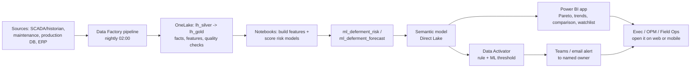

# How the Customer Sees Results — and How Fabric Actually "Comes In"

> Plain-language explainer for the Deferment Root-Cause & Production Loss Prediction use case.
> Short answer: **the customer never opens Fabric. They open Power BI and get alerts — and Power BI *is* Fabric.** Fabric is not where the data sits; it is the whole factory that turns sitting data into decisions.

---

## 1. The misconception: "Fabric is just where the data sits"

Today NewCross has Microsoft Fabric and an enterprise data warehouse. All they can see is a **lakehouse full of tables** (`lh_silver`) — which looks exactly like "a place the data sits." That is only **one workload out of about eight** in Fabric, and it is the *least valuable* one.

If Fabric were only storage, you would still be buying and stitching together separate tools for:

| You need… | Legacy world | Fabric workload that does it |
|---|---|---|
| Move/copy/schedule data | ADF / SSIS / scripts | **Data Factory** (pipelines, Dataflows Gen2, Airflow) |
| Transform at scale | Databricks / Synapse | **Data Engineering** (Spark notebooks, SQL) |
| Store in one place | ADLS / SQL DW | **OneLake + Lakehouse + Warehouse** |
| Train & score ML | Azure ML / Databricks | **Data Science** (MLflow, notebooks, PREDICT) |
| Real-time signals | Kafka / Stream Analytics | **Real-Time Intelligence** (Eventstream, KQL) |
| Analytics UI | Power BI (separate) | **Power BI** (now a Fabric workload) |
| Take action | Logic Apps / custom code | **Data Activator** (alerts → Teams/email) |
| AI assistance | OpenAI etc. | **Copilot / Fabric AI / Data Agents** |

Fabric collapses all of these onto **one copy of data, one security model, one capacity, one governance layer, one bill**. That integration *is* how Fabric comes in. The lakehouse is the pantry; Fabric is the kitchen, the chef, the waiter, and the doorbell.

---

## 2. Front stage vs. back stage

The cleanest way to answer "how does the customer see results?" — separate what happens behind the curtain from what the customer touches.

### Back stage (the engine room — nobody looks at this daily)
- **OneLake / lakehouses** — data at rest (the "sitting" part)
- **Pipelines** — movement + scheduling
- **Notebooks / Spark / SQL** — cleaning, features, Pareto logic
- **MLflow + models** — learning, scoring
- **Semantic model** — governed business logic (definitions, measures)
- **Data quality tests & monitoring** — trust

### Front stage (everything the customer actually sees)
- **Power BI report / app** — browser, mobile, embedded in Teams/SharePoint
- **Teams & email alerts** — from Data Activator, routed to a named owner
- **Scheduled email subscriptions** — the report arrives on its own
- **Excel "Analyze in Excel"** — live pivot over the same model
- **AI narratives** — plain-language insight inside the report
- **Later:** MAF-generated, pre-approved reports

> The customer experiences **Power BI + notifications**. Those *are* the visible tip of the Fabric stack — Power BI runs on Fabric capacity and reads Fabric data through the semantic model. There is no separate "reporting tool" bolted on.

---

## 3. Where each deliverable lands for the customer

| Use-case output | What the customer physically sees | Fabric pieces behind it |
|---|---|---|
| Pareto by cause/field/station | A report page with a ranked bar + cumulative line | Gold tables → semantic model → Power BI |
| Volume bridge (potential→causes→actual) | A waterfall page | Potential engine notebook → Direct Lake |
| Trend & recurring drivers | Line/heatmap pages | Time-series tables → Power BI |
| Field/flow-station comparison | Ranked bars + heatmap | Benchmarking tables → Power BI |
| Early-warning flags | A ranked "watchlist" page **and** a Teams alert | ML scoring table → Power BI + Data Activator |
| Forecast / target variance | KPI tiles + trend with bands | Forecasting model → semantic model |
| Daily freshness | Nothing to do — it's just current | Pipelines + scheduled refresh |

Nothing here is "the customer reading a table in a lakehouse." Every output is a **decision surface**.

---

## 4. The end-to-end flow the customer lives through

**A day in the customer's life**
1. **02:00** — automated pipeline refreshes gold data; quality tests pass.
2. **02:20** — models score; risk table updated.
3. **02:30** — semantic model refreshes automatically (Direct Lake sees new Delta data).
4. **06:00** — a well breaches a loss-event rule → **Teams alert** with well, cause, barrels, and a link.
5. **08:00** — the ops/asset stand-up opens the **Power BI watchlist** and Pareto; prioritises interventions.
6. **During the day** — an analyst opens the report, clicks a cause, drills to the field/station, and reads an **AI narrative**.
7. **Weekly** — exec reviews deferment % vs. target and value at risk; the model retrains quietly in the background.

The customer's experience: **"the answer was already waiting, and it told me what to do."**

---

## 5. Why Fabric can't be "just storage" here

The moment you try to deliver the four outputs, you are forced out of the storage workload:

- **Pareto needs computation** → Spark/SQL notebooks (Data Engineering).
- **Early warning needs a model** → Data Science + MLflow + batch scoring.
- **Trends need time-series transforms** → notebooks/warehouse.
- **The report needs governed logic** → semantic model (Direct Lake).
- **The alert needs an actor** → Data Activator.
- **The narrative needs AI** → Copilot/Fabric AI.

That is why the answer is: **Fabric is the assembly line, not the shelf.** The data sitting in `lh_silver` is the raw material; the value is created and delivered in the workloads layered on top of it.

---

## 6. The "one copy" advantage the customer feels

Because every engine reads the **same Delta tables in OneLake**:

- The ML notebook and Power BI read the **same numbers** — no exports, no stale CSV, no "whose version is right?"
- Power BI **Direct Lake** queries the gold tables directly → fast and always current.
- One **security model** and **governance** (Purview, sensitivity labels, RLS) apply everywhere.
- One **capacity (F16)** powers storage, compute, and BI — predictable cost.

This is the concrete payoff of "Fabric, not storage + a separate BI tool": the report is never a copy-of-a-copy.

---

## 7. Who sees what

| Persona | Surface | Cadence |
|---|---|---|
| CEO / Exec | Power BI exec page, KPI tiles, value-at-risk, AI narrative | Weekly / monthly |
| Asset Manager / OPM | Asset + flow-station comparison, intervention priorities | Daily / weekly |
| Production / Field Ops | Early-warning watchlist, event timeline, Teams alerts | Real-time / daily |
| Maintenance / Reliability | Predicted-failure alerts, RTO list | On alert |
| Business Excellence | Pareto, standardized cause reporting | Monthly |
| Data / IT team | Fabric workspaces, pipelines, monitoring (the back stage) | Continuous |

Only the last group ever lives inside Fabric. Everyone else consumes the results through Power BI and alerts.

---

## 8. Licensing / access (how they literally get in)

- The **F16 Fabric capacity** powers the whole stack (storage, compute, semantic models).
- Consumers view reports through the **Power BI service / app** (Power BI Pro/PPU entitlement as applicable), on web or mobile, or embedded in **Teams/SharePoint**.
- Alerts arrive through **Teams/email** — recipients don't need to open Power BI at all for the "push" experience.
- After go-live, **managed services** keeps pipelines, models, and refreshes healthy — the customer keeps receiving results without operating the machinery.

---

## 9. One-paragraph answer

The customer sees results in **Power BI and Teams alerts** — ranked Pareto, trends, comparisons, a daily early-warning watchlist, forecasts, and plain-language narratives, all refreshed automatically. **Power BI is now a Fabric workload**, and the semantic model behind it reads the same OneLake Delta tables the ML notebooks write. So Fabric is not a place data sits; it is the **single platform where data is moved, cleaned, modeled, scored, served, and acted upon** — the data-at-rest in `lh_silver` is merely the starting raw material, and the visible value is delivered through the workloads built on top of it.

---

*Companion to `deferment-ml-engineering-blueprint.md` (how it's built) and `deferment-fabric-build-spec.md` (the build + customer offer).*
