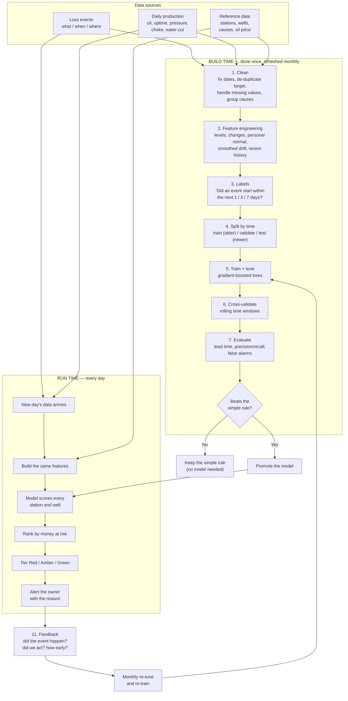

# How the Early-Warning Model Works — Plain-Language Guide

> Programme: Advanced Analytics & AI · Workstream: Deferment Root-Cause & Production Loss Prediction
> Audience: business, operations and engineering readers (no data-science background needed)
> Status: explainer · Version 0.1 · 2026-10-08

---

## 1. The one-line version

We are building a **monitor for each flow station** that learns what "normal" looks like, watches for the early signs that normally come before a loss, and raises a flag **before** the loss is recorded.

**Analogy:** a hospital vitals monitor. It learns each patient's normal heart rate and blood pressure, then beeps when something drifts — long before the patient collapses.

---

## 2. The end-to-end picture



### The same picture for a terminal

```
BUILD  (once, then refreshed monthly)          RUN  (every day)
──────────────────────────────────────        ───────────────────────────────
 clean  →  features  →  labels                 new day's data  →  features
   →  split by time  →  train + tune              →  score  →  rank by money
   →  cross-validate  →  evaluate                 →  tier  →  alert the owner
   →  beats simple rule? ──yes──▶ promote                                │
                  │                                                      │
                  └──no──▶ keep simple rule                              ▼
                                                                   feedback
        ▲                                                              │
        └──────────── monthly re-tune + re-train ◀────────────────────┘
```

---

## 3. What we are building (the pieces)

| Piece | Plain meaning |
|---|---|
| A daily "vitals" table | One row per station per day holding all its signals |
| A "normal" profile | What is usual for *that* station (not the whole field) |
| A drift detector | Flags when a signal leaves its normal range |
| A scoring model | Estimates the chance of a loss in the next few days |
| A ranked list + alerts | Sorted by money at stake, sent to the right person |
| A feedback log | Records whether the warning turned out to be right |

---

## 4. The data we start with

- **About two years of daily loss events** — what was lost, when, where, and (sometimes) why.
- **Daily production** — oil produced, target, uptime hours, wellhead pressure (THP), choke size (bean), water cut.
- **Reference tables** — flow stations, wells, causes, oil price.

*Reality check from the actual data: 40,290 events across 5 flow stations and 71 wells; about 86% of cause codes are unusable; roughly 25% of pressure/choke readings are missing.*

---

## 5. The steps, one at a time

### Step 1 — Cleaning
- Fix the date handling (the production table stores dates as numbers, e.g. `20241001`).
- De-duplicate the target: it is a station-level number repeated on every well row, so naive summing inflates it about 15×.
- Handle missing signals honestly — mark them as missing, never fake a zero.
- Fix or group the cause codes (86% currently read "Mismatch").
- Remove duplicates and reject impossible values (for example, negative volumes).
- **Why:** garbage in, garbage out. Everything later depends on this.

### Step 2 — Feature engineering (building the clues)
A **feature** is one clue — a number describing a station or well on a given day.

| Kind of clue | Example |
|---|---|
| **Level** | Today's uptime, pressure, choke, water cut, oil produced |
| **Change** | How much pressure fell versus yesterday or versus 7 days ago |
| **Personal normal** | How far today is from *this station's own* usual (a deviation score) |
| **Smoothed drift** | A slow-moving average that catches gradual decline |
| **History** | How many events in the last 7 days; days since the last event |

The result is **one row per station per day** (and per well) holding all the clues.

### Step 3 — Labels (the answer key)
We add the answer we want the model to learn:

> "Did a loss event **start within the next 1, 3, or 7 days**? Yes or No."

*Important:* because about 95% of days already contain *some* loss, we predict the **start of a specific event** or a **large loss day** — not "any loss". Predicting "any loss" would be trivially always-yes.

### Step 4 — Splitting the data (a time machine, not a shuffle)
- Train on **older** data, test on **newer** data. Always.
- **Never split randomly** — that would let the model peek at the future and cheat.
- Example split: train Oct 2024 – Sep 2025; validate Oct 2025 – Mar 2026; test Apr 2026 – Oct 2026.

### Step 5 — Which model
We start simple and only graduate when there is proof it helps.

| Order | Model | Why |
|---|---|---|
| 0 | "Yesterday's loss" | A sanity baseline — shows why simple is too late |
| 1 | **Deviation rule** (alarm when a signal leaves its normal) | Transparent, needs no training, works immediately |
| 2 | **Gradient-boosted trees** (LightGBM / XGBoost) | The workhorse for this kind of table data; handles missing values; tells you which clues mattered |
| 3 | **Survival model** (companion) | Estimates *how many days until* onset — gives the lead time |

**Why not deep learning?** The dataset is small (5 stations, ~2 years, daily), single failures are rare, and operators need explanations. Tree models win here. We would revisit deep models with hourly data and more history.

The model outputs a **probability from 0 to 1**: for example, "70% chance of an event within 3 days".

### Step 6 — Training
- Show the model many past days, each with its **clues** and the **answer**.
- It learns patterns such as *"uptime below normal AND pressure falling for 3 days → higher risk."*
- Because events are rare, we weight them so the model does not simply ignore them.
- Crucially, **the model never sees the test period** while training.

### Step 7 — Cross-validation (time-aware)
- Cut history into consecutive blocks; train on the past, test on the next block; roll forward and repeat.
- Gives a stable, honest score instead of one lucky result.
- **Not** the usual random k-fold — for the same reason as Step 4.

### Step 8 — Tuning
- **Knobs inside the model:** tree depth, learning rate, number of trees. Adjusted gently.
- **The bigger lever is the decision line:** how high a risk score must be before an alert fires, and **how many alerts per week** an operator can handle.
- We tune for the **business goal** — the most days of warning at an acceptable false-alarm rate — not for a textbook metric.

### Step 9 — Evaluation (the real test)
| Measure | Meaning |
|---|---|
| **Lead time (days)** | How early, on average, we flagged before the event — **the headline number** |
| **Precision / recall (PR-AUC)** | Of the flags raised, how many were real; of the real events, how many we caught |
| **False alarms per station per week** | Whether operators would trust it |
| **Head-to-head versus the simple rule** | If the model is not earlier, we keep the simple rule |

We never use plain "accuracy" — with rare events, "always say no" would score above 90% and be useless.

### Step 10 — From score to action
- `Priority = risk × expected barrels at risk × oil price`
- Tier it **Red / Amber / Green**.
- Alert the owner with the reason: which station or well, likely cause, how soon, barrels and value at risk, and what to check.

### Step 11 — Feedback and retraining
- Record what happened: did the event occur? Did the team act? How early was the warning?
- Re-tune thresholds monthly; retrain the model as new outcomes accumulate.
- Over time this makes warnings **earlier without crying wolf**.

---

## 6. Is this a time-series solution?

Yes — it is built on **time-series data** — but the model is **event prediction**, not classic value forecasting. The distinction matters, because "time series" often sets the wrong expectation (ARIMA/Prophet predicting next month's numbers).

**Where the time-series nature shows up**

| Aspect | Why it is time series |
|---|---|
| Data | Daily observations per station and well over about two years |
| Features | Lags, slopes, rolling means, smoothed drift — the time is engineered into the clues |
| Splitting | Chronological only (train on past, test on future) — never random |
| Detection | Finding drift and change points in a signal |
| Evaluation | Lead time — how many days ahead |
| Maintenance | Retraining as behaviour drifts over time |

**What each component actually does**

| Component | Task | Flavour |
|---|---|---|
| Deviation engine | Detect anomalies and change points in each signal | Time series |
| Onset model | Predict "event within the next 1 / 3 / 7 days?" from lagged clues | Time series turned into classification |
| Survival model | Estimate time until onset | Time series / survival |
| Expected loss | Short forecast of barrels and value at risk | This one is forecasting |

**In one sentence:** a leading-indicator / early-warning solution built on time-series data, delivered mainly as **event prediction plus anomaly and survival analysis**, with a small **forecasting** component for the money at risk.

**Why not ARIMA / Prophet / deep sequence models**
- ARIMA/Prophet forecast a series' next values. Here the series is almost always "loss happening" (about 95% of days), so forecasting it is accurate but not useful — and it fires *after* the loss starts.
- Deep sequence models need far more data and a higher frequency than 5 stations × ~2 years of daily history, and cannot explain *why*.
- Tabular models on engineered temporal clues win at this scale, and the three clocks (lags, rolling windows, deviations) already carry the time information.

> A production-volume **forecast dashboard** is a *different* deliverable — complementary, not the same thing. Our answer to "detect risk earlier" is **event prediction and deviation detection**, not forecasting.

> **Deeper detail:** see the standalone note `model-framing-time-series-vs-forecasting.md` for the full comparison with classic forecasting.

---

## 7. A worked example

> **Wednesday — Station X, Well Y**
> - Uptime today: **6 h** (its normal: 22 h) — falling for 3 days
> - Wellhead pressure: **300** (normal 850) — falling
> - Deviation scores are high on both signals
> - Model: **P(event within 3 days) = 0.70**
> - Expected loss: 1,200 bbl × $80 = **$96,000**
> - → **Red alert**: *"Well Y, likely well/flowline issue within ~3 days, ~$96k at risk."*

---

## 8. What "good" looks like

> *"For well-flow events, we warn about 5 days ahead, with fewer than 5 false alarms per station per week, and every flag explains itself."*

Each station gets its own normal, so comparisons between stations are fair.

---

## 9. Glossary (plain meanings)

| Term | Plain meaning |
|---|---|
| **Feature** | One clue about a station or well on a day |
| **Label** | The answer we want the model to predict |
| **Training** | Showing the model many past days with clues and answers |
| **Overfitting** | Memorising the past instead of learning the pattern |
| **Cross-validation** | Testing on several consecutive time blocks to be sure |
| **Precision / recall** | How many flags were real / how many real events we caught |
| **Lead time** | How many days early a warning fires |
| **Survival model** | A model that estimates time until an event |
| **EWMA / CUSUM** | Methods that detect slow, gradual drift in a signal |
| **Deviation / z-score** | How far a value is from its own normal |

---

*Plain-language explainer, 2026-10-08. Numbers are drawn from the current operational data and are indicative.*
