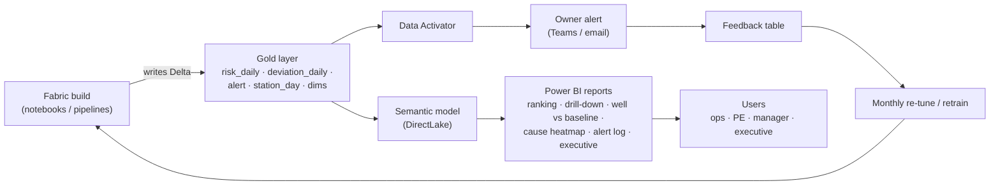

# PRD — Deferment Early-Warning System

> Product: **Advanced Analytics & AI — Part 1, Project 1 (Deferment Root-Cause & Production Loss Prediction)**
> Scope of this PRD: the **early-warning** capability only — *"How to detect the risk earlier?"*
> Client: NewCross Exploration & Production (OML 24) · Platform: Microsoft Fabric
> Status: Draft for Discovery · Version 0.1 · Date: 2026-10-08
> Related: `early-warning-architecture.md`, `early-warning-model-design.md`, `early-warning-patterns.md`, `data-quality-findings.md`

---

## 1. Problem statement

Deferment is recorded **after** the barrels are already lost. Today the business learns about a loss when it appears in the deferment log or the monthly report — too late to act. Analysis of 24 months of real data shows:

- Deferment occurs on ~**95% of station-days**, so the problem is not *occurrence* but **onset, severity and change**.
- Loss is **highly persistent** (lag-1 autocorr 0.45–0.82) — "yesterday's loss" is accurate but late.
- For chronic causes, **the physical signal leads the log by ≥7 days** (e.g. Well No-Flow: THP already ~290 vs normal 871, uptime ~4 h vs 19.8, a week before the code appears).
- **86% of events carry no usable cause code** (`Mismatch`), so *why* is unreliable — but *when* can still be detected from process signals.

## 2. Objective

Detect emerging deferment risk **earlier than the deferment log**, per flow station and production string, explain it, rank it by money at stake, and alert the owner while there is still time to act — then learn from outcomes.

## 3. Goals & success metrics

| # | Goal | Metric | Target (initial) |
|---|---|---|---|
| G1 | Warn earlier than the log | **Median lead time** before a coded onset (chronic cause groups) | ≥ 3–7 days |
| G2 | Warn accurately | Recall at fixed alert budget / PR-AUC | recall ≥ 0.5 at ≤ 5 alerts/station/week |
| G3 | Don't cry wolf | False alarms per station per week | ≤ 5 |
| G4 | Explain every flag | % alerts with a stated reason + entity baseline | 100% |
| G5 | Per-station fairness | % stations with own baseline & enough data | 100% |
| G6 | Data fitness for cause analysis | % deferment events with a valid cause code | ≥ 95% (currently ~13.5%) |
| G7 | Adoption | % Red/Amber alerts acknowledged / acted | ≥ 80% acknowledged |

## 4. Non-goals

- Root-cause *why* analytics beyond what codes allow (enabled later by G6).
- Supply-chain, production forecasting, report redesign, MAF (other projects).
- Real-time (< 1 h) detection in v1 — batch daily first; streaming later.
- Writes to source systems — read-only throughout.

## 5. Users & personas

| Persona | Need | Interaction |
|---|---|---|
| Production/Ops engineer | "What's about to hit me, and why?" | Alerts + station/string drill-down |
| Asset/OPM manager | Ranked risk by value, cross-station comparison | Dashboard |
| PE/Well engineer | Precursor detail for a well/string | Drill-through, trend vs own baseline |
| Data/analytics engineer | Reproducible features, models, backtests | Pipelines, notebooks, registry |

## 6. Key user stories

1. As an **ops engineer**, I get an alert for a station/string **days before** a failure, with the likely cause group and barrels at stake, so I can intervene.
2. As an **asset manager**, I see a **ranked list of stations** by risk × value and can compare them fairly (normalised).
3. As a **PE**, I drill into a station and see which signal deviated from its **own normal** and when.
4. As an **analyst**, I can reproduce any flag and see the model version, thresholds and data window.
5. As a **manager**, I can see how many alerts were right, how early they fired, and how they improved.

## 7. Functional requirements

| ID | Requirement |
|---|---|
| FR1 | Ingest daily `wh_gold` (deferment, production, dims, prices) plus external feeds (historian, CMMS, power) into bronze |
| FR2 | Normalise raw cause drivers into a canonical cause hierarchy; report completeness |
| FR3 | Reconstruct event episodes and duration where possible |
| FR4 | Deduplicate station-level `target_oil`; compute versioned `potential` |
| FR5 | Learn a **baseline per entity** (station, string) per signal, with seasonality |
| FR6 | Compute deviations per entity-day: z-score, EWMA, CUSUM, change-point |
| FR7 | Produce **onset labels** (onset within H ∈ {1,3,7} days) and severity labels |
| FR8 | Score **P(onset within H)** per entity-day (L2) + survival lead-time |
| FR9 | Rank by value = P × expected bbl × oil price (L3) |
| FR10 | Tier Red/Amber/Green and route alerts to owners with reasons |
| FR11 | Dashboards: ranked stations, string drill-down, cause heatmap, trend vs own baseline |
| FR12 | Capture outcomes (event occurred? acted?) and compute realised lead time & false alarms |
| FR13 | Daily data-quality monitoring & gates (volume, coverage, completeness, nulls) |
| FR14 | Config-as-data: thresholds, horizons, cause groupings, alert budgets |
| FR15 | Model/feature versioning and chronological backtest reports |

## 8. Non-functional requirements

| ID | NFR |
|---|---|
| NFR1 | Read-only on all sources; no writes to `wh_gold` |
| NFR2 | Daily batch completes off-peak; future streaming ≤ 1 h freshness |
| NFR3 | Explainable: every flag carries reason + baseline comparison |
| NFR4 | Scalable to multi-asset (OML 147/152 already present) |
| NFR5 | Capacity-aware (bounded scans; prefer OneLake reads) |
| NFR6 | Data stays in the NewCross tenant; least privilege; secrets managed |
| NFR7 | Degrade gracefully on missing feeds ("insufficient data" state) |
| NFR8 | Auditable: every run/query logged; model card per version |

## 9. Data & dependencies

- **Have:** `wh_gold` `production.*` (deferment_fact, production_fact, dims, oil_prices) — 24 months.
- **Need:** historian (hourly THP/bean/pressure), CMMS/work orders, power/trip logs, weather, community/security, drilling/shutdown plans.
- **Blocker:** cause-code quality (86% `Mismatch`) gates cause-*specific* modelling.
- **Dependency:** read-only identity in the NewCross tenant (currently an admin account — to be replaced).

## 10. Constraints & assumptions

- Daily granularity now; ~24 months of history (below preferred 36).
- No event duration in `deferment_fact`.
- All thresholds/horizons are proposals to confirm.
- Scope question open: OML 24 only, or include OML 147/152?

## 11. Solution overview

Layered early-warning system on Fabric: medallion lakehouses → entity-day features & per-entity baselines → **L1 deviation engine → L2 onset model + survival → L3 value ranking** → `gold.deferment_risk_daily` → Power BI + Data Activator → outcome feedback. Full detail in `early-warning-architecture.md` and `early-warning-model-design.md`.

## 12. Deliverables & Outputs

### 12.1 Operational outputs (used day to day)

| Output | Content | Audience |
|---|---|---|
| **Daily risk table** | One row per flow station and per well: risk, tier, top reasons, expected barrels, expected value | system / BI |
| **Ranked risk list** | Stations and wells sorted by money at stake | Asset / OPM manager |
| **Alerts** | Red/Amber pushed to the owner with reason, value and link | Operations / PE engineer |
| **Dashboards** | Station ranking, drill-down to well, trend vs own baseline, cause heatmap | Ops, manager, executive |

### 12.2 Analytical & data outputs

- Per-entity "normal" profiles (baselines) for each station and well.
- Daily deviation signals with direction and magnitude.
- **Lead-time and false-alarm report** — the headline proof of "earlier".
- Trained model, backtest report and model card.
- Curated tables: conformed production-day, event episodes, entity-day features, daily risk.
- Data-quality report (volume, coverage, integrity, missing signals, cause completeness).

### 12.3 Shape of the result — it is *not* binary

The raw output is a **rich, explainable record**; a binary decision is only a derived view on top of it.

| Field | Type | Example |
|---|---|---|
| `risk_prob` | continuous 0–1 | 0.70 |
| `risk_tier` | categorical | Red / Amber / Green |
| `horizon_days` | integer | 3 |
| `est_lead_days` | number (optional) | ~3.5 days |
| `top_reasons` | text list | "pressure 40% below its normal; uptime 6h vs 22h normal" |
| `deviation_score` | number | 2.8 |
| `exp_deferred_bbl` | number | 1,200 |
| `exp_value_usd` | number | 96,000 |

A binary value (for example "alert fired: yes/no") is derived from the tier threshold; the underlying result keeps the probability, the reasons and the money at stake.

### 12.4 Forward-looking outputs

- **Risk probability** — the chance of an onset within the next 1 / 3 / 7 days (predictive).
- **Expected loss** — a short forecast of deferred barrels and value at risk from the probability and recent loss rate.

This is *not* a production-volume forecast (that is a separate project); it is a risk forecast that can be combined with one.

**Note on framing:** this is **event prediction on time-series data**, not classic value forecasting (ARIMA/Prophet). The data is time series; the core model predicts *whether an event will start soon*, supported by anomaly and survival analysis, with a small forecasting element for the value at risk. See `model-framing-time-series-vs-forecasting.md` for the full explanation.

### 12.5 Output data structure (star schema)

| Table | Grain | Key columns |
|---|---|---|
| `risk_daily` (fact) | entity × day | date, station, well, risk_prob, tier, reasons, exp_bbl, exp_usd, horizon, model_version |
| `deviation_daily` (fact) | entity × day × signal | date, entity, signal, value, baseline, deviation, direction, is_anomaly |
| `alert` (fact) | alert | alert_id, date, entity, tier, reasons, exp_usd, owner, status, outcome |
| `station_day` (context fact) | station × day | actual, target, potential, deferred, deferment %, events |
| `dim_date`, `dim_station`, `dim_well`, `dim_cause`, `dim_signal`, `dim_tier` | reference | labels and hierarchies |

### 12.6 Reporting & consumption (Power BI on Fabric)

The output is consumed in the same workspace it is built in. The findings (**Delta tables**) are written to the gold layer, modelled by a **semantic model**, and surfaced through **Power BI** and **Data Activator**.

**How the findings are loaded and surfaced:**
1. The build writes the output tables as Delta into the gold lakehouse/warehouse (`risk_daily`, `deviation_daily`, `alert`, `station_day`, and the dimensions).
2. A **semantic model** is created over those tables using **DirectLake** (fast, no copy) with fallback to Import.
3. **Power BI report pages:** ranked stations by value at risk; station drill-down; well detail with trend versus its own baseline; cause heatmap; alert log and precision; executive summary.
4. **Measures** are defined in the model: count and value of risks, median lead time, alert precision, false alarms per station per week, coverage.
5. **Data Activator** subscribes to the daily risk table to raise Red/Amber alerts to the mapped owner, with repeat alerts suppressed.
6. The report is published as an **app** to the client workspace; **row-level security** restricts visibility by asset if required.
7. **Refresh:** DirectLake stays in step with the lakehouse; otherwise a scheduled refresh runs after the daily build.
8. Outcomes flow back through the feedback table, and the loop re-tunes and retrains monthly.

### 12.7 Results the project is judged on

Median lead time (days); false alarms per station per week; share of real events that were warned about; value of losses flagged early; share of alerts acted on.

---

## 13. Delivery approach — vertical slices

Each slice is a **thin end-to-end increment** (data → feature → score → surface), independently demoable, ordered by value and risk. No slice delivers only a layer.

| Issue | Slice | Delivers (demo) | Depends on |
|---|---|---|---|
| ISS-001 | Enabler | Read-only identity + DQ monitoring gate | — |
| ISS-002 | Enabler | Cause taxonomy normalisation + completeness KPI | ISS-001 |
| ISS-003 | Enabler | Episode & duration reconstruction | ISS-001 |
| ISS-004 | Enabler | Target dedup + versioned potential | ISS-001 |
| ISS-005 | VS1 | Station-day deferment mart + cross-station ranking view | ISS-004 |
| ISS-006 | VS2 | L1 deviation v1 (uptime) → daily anomaly flags + view | ISS-004 |
| ISS-007 | VS3 | L1 v2 (all signals, EWMA/CUSUM, reasons, change-point) | ISS-006 |
| ISS-008 | VS4 | **Lead-time measurement harness** → lead-time & false-alarm report | ISS-003, ISS-007 |
| ISS-009 | VS5 | Onset labels + L2 model v1 (one cause group) + backtest | ISS-007, ISS-008 |
| ISS-010 | VS6 | L3 value ranking + tiering → risk_daily + Power BI view | ISS-006, ISS-005 |
| ISS-011 | VS7 | Data Activator alerts (Red/Amber) + owner routing | ISS-010 |
| ISS-012 | VS8 | Feedback loop → realised lead time + tuning | ISS-011 |
| ISS-013 | VS9 | Fabric productionisation (pipelines + notebooks) | ISS-005..ISS-010 |
| ISS-014 | VS10 | Real-time historian → hourly risk (future) | ISS-013, historian feed |
| ISS-015 | VS11 | Gold output tables + semantic model (DirectLake) + measures | ISS-010 |
| ISS-016 | VS12 | Power BI report pages (ranking, drill-down, well-vs-baseline, heatmap, alert log, exec) | ISS-015 |
| ISS-017 | VS13 | Publish app, RLS, refresh schedule & distribution | ISS-016, ISS-011 |

**Phase 0 (ISS-001–008, 010) can run on the current local prototype** (read-only connector + duckdb) before Fabric productionisation (ISS-013).

## 14. Milestones

- **M1 (Phase 0):** L1 deviation + **measured lead-time number** (ISS-001–008). *Proves "earlier" is real.*
- **M2:** Value ranking + dashboard + alerts (ISS-009? → ISS-010, ISS-011).
- **M3:** Learned onset model + feedback loop (ISS-009, ISS-012).
- **M4:** Fabric productionisation + real-time (ISS-013, ISS-014).

## 15. Risks & mitigations

| Risk | Impact | Mitigation |
|---|---|---|
| Cause codes stay at 86% `Mismatch` | No cause-specific model | L1 works without codes; push taxonomy fix (ISS-002) |
| Daily data too coarse for abrupt causes | Miss power/facility trips | Add historian/power feeds; higher frequency |
| Class imbalance / few positives | Overfit | Chronological backtest, PR-AUC, simplicity first |
| Alert fatigue | Ignored warnings | Alert budget, Red/Amber only, measure precision |
| Admin account privilege | Security | Move to read-only identity (ISS-001) |
| Source data changes | Broken pipeline | DQ gates, schema-drift alerts |

## 16. Open questions

1. Scope: OML 24 only, or OML 147/152 too?
2. Who owns the cause-taxonomy fix, and when?
3. Historian availability/frequency → real-time feasibility?
4. Horizons H (1/3/7 d) — confirm after lead-time measurement.
5. Alert budget per station/week?
6. Provide a read-only identity for ongoing access?

---

*Draft PRD, 2026-10-08. All targets and thresholds are proposals pending Discovery.*
