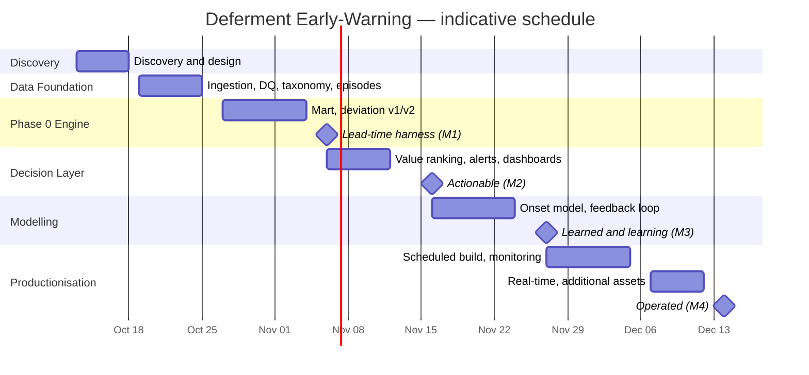

# Work Breakdown Structure — Deferment Early-Warning Solution

> Programme: Advanced Analytics & AI · Workstream: Deferment Root-Cause & Production Loss Prediction
> Client: NewCross Exploration & Production · Platform: Microsoft Fabric
> Version 0.1 (draft for review) · 2026-10-08

---

## 1. Purpose of this document

This document defines the **full build** of the Deferment Early-Warning Solution as a Work Breakdown Structure (WBS): the phases, the work packages, what each delivers, how it is judged complete, and the effort involved. It is written to be read on its own — no other document is required to understand it.

---

## 2. Solution context (what is being built)

**The problem.** Deferment — production lost because a well, flowline, or facility is down — is recorded *after* the barrels are lost. The business learns about a loss from the deferment log or a monthly report, too late to intervene. Analysis of two years of operational history shows three facts that shape the build:

- Deferment is present on almost every day at almost every flow station, so the challenge is not *whether* loss occurs but **detecting the onset, the severity, and the change**.
- Loss is highly persistent — a bad day tends to follow a bad day — so "today looks like yesterday" is accurate but arrives too late to act on.
- For the chronic causes, the **process signals move days before the loss is recorded** (for example, wellhead pressure and uptime collapse about a week before a "Well No-Flow" entry appears). The physical signal is the early warning; the log lags it.

**The solution.** A system that, every day, scores each flow station and production string for the **risk of an impending deferment**, explains *why*, ranks it by money at stake, and raises an alert early enough for the owner to act — then learns from what happened.

**The approach** is layered, so value is delivered before the most advanced parts exist:

1. **Baseline & deviation engine** — learn what is "normal" for each station and string, and detect when a signal departs from that normal.
2. **Lead-time measurement** — prove how many days early a flag fires, at an acceptable false-alarm rate.
3. **Value ranking & alerting** — turn scores into ranked, money-aware warnings routed to the right person.
4. **Predictive modelling** — a learned onset model, added only if it measurably warns earlier than the deviation engine.
5. **Feedback loop** — capture whether alerts were right and acted on, and tune continuously.

**The data** spans around two years of daily deferment events, production actuals and targets, wellhead/process signals (pressure, choke, water cut, uptime), flow-station and reservoir reference data, and oil prices across three assets.

---

## 3. Scope

**In scope**
- Building the data foundation (ingestion, cleansing, cause taxonomy, event episodes, potential/gap measures, data-quality gates).
- Building the per-entity baseline and deviation engine.
- Measuring and proving lead time.
- Building value ranking, tiering and alerting, and the supporting dashboards.
- Building and validating the learned onset model and the feedback loop.
- Productionising the solution on the platform (scheduled pipelines, monitoring) and extending to real-time signals and additional assets.

**Out of scope**
- Supply-chain analytics, production forecasting, report redesign, and multi-agent automation (separate workstreams).
- Any write-back to source operational systems.
- Procurement of third-party systems.

### 3.1 Coverage across flow stations

The build is deliberately **per-entity**: the deviation engine (1.4) and the risk table (1.6.1) compute a baseline and a score **for every flow station and every production string**, so the same build applies to each station without change. The initial build covers all flow stations in scope:

| Asset | Flow station | Strings | Deferment events | Production days | THP missing | Bean missing | Relative readiness |
|---|---|---:|---:|---:|---:|---:|---|
| OML 24 | Ekulama 2 | 20 | 11,346 | 694 | 22% | 23% | High |
| OML 24 | Ekulama 1 | 23 | 10,675 | 687 | 13% | 18% | High |
| OML 147 | OML 147 | 13 | 8,894 | 695 | 29% | 29% | Medium |
| OML 24 | Awoba | 25 | 6,280 | 697 | 29% | 36% | Medium |
| OML 152 | EFE | 6 | 3,095 | 641 | 35% | 40% | Lower |

**How coverage is handled**
- Every station receives its own baseline and its own daily risk score — there is no fleet-wide threshold.
- Stations are compared only after normalisation (risk as a share of potential, events per well, per thousand barrels), so no station is penalised for being larger or smaller.
- Where a station has too few occurrences of a cause to model individually, it falls back to a pooled station- or asset-level rule rather than a per-string model.
- Stations on assets added later are handled by the extension package (1.7.4).

**Per-station acceptance (applies to every station)**
- The station produces a daily risk score with at least one stated reason.
- The station passes a minimum data-coverage check for the signals it relies on.
- The station's alert precision/false-alarm rate is measured and reported individually, not only in aggregate.

> Note: at **Ekulama 1** the deferment records reference more production strings than the production data does (50 vs 23). String-level joins at that station require a reconciliation step; where alignment is imperfect, scoring falls back to station level.

---

## 4. WBS overview

```
1.0  Deferment Early-Warning Solution
├── 1.1  Project Management & Governance
│   ├── 1.1.1  Sprint and delivery management
│   ├── 1.1.2  Risk and issue management
│   ├── 1.1.3  Stakeholder communication and status reporting
│   └── 1.1.4  Stage-gate reviews and sign-offs
├── 1.2  Discovery & Solution Design
│   ├── 1.2.1  Discovery workshops and requirements
│   ├── 1.2.2  Value definition, KPI baseline and targets
│   ├── 1.2.3  Cause-taxonomy gap analysis
│   └── 1.2.4  Solution architecture and data contracts
├── 1.3  Data Foundation
│   ├── 1.3.1  Source ingestion pipelines
│   ├── 1.3.2  Data-quality gate and validation
│   ├── 1.3.3  Cause-taxonomy normalisation
│   ├── 1.3.4  Event episode and duration reconstruction
│   ├── 1.3.5  Target de-duplication and potential measure
│   └── 1.3.6  External signal ingestion
├── 1.4  Early-Warning Analytics Engine (Phase 0)
│   ├── 1.4.1  Station-day mart and cross-station ranking
│   ├── 1.4.2  Deviation engine v1 (single signal)
│   ├── 1.4.3  Deviation engine v2 (all signals, SPC)
│   └── 1.4.4  Lead-time measurement harness
├── 1.5  Predictive Modelling
│   ├── 1.5.1  Onset labels and supervised model
│   ├── 1.5.2  Survival / lead-time model
│   ├── 1.5.3  Backtesting and model governance
│   └── 1.5.4  Feedback loop and threshold tuning
├── 1.6  Decision & Alerting Layer
│   ├── 1.6.1  Value ranking and risk tiering
│   ├── 1.6.2  Alerting and owner routing
│   └── 1.6.3  Dashboards and reporting views
├── 1.7  Productionisation & Scale
│   ├── 1.7.1  Scheduled build pipelines
│   ├── 1.7.2  Monitoring, observability and capacity
│   ├── 1.7.3  Real-time signal streaming
│   └── 1.7.4  Extension to additional assets
└── 1.8  Adoption, Knowledge Transfer & Closure
    ├── 1.8.1  User acceptance testing
    ├── 1.8.2  Training and documentation
    ├── 1.8.3  Handover to support
    └── 1.8.4  Benefits review and lessons learned
```

---

## 5. WBS dictionary

| WBS | Work package | Deliverable | Acceptance criteria | Depends on | Effort (p-d) |
|---|---|---|---|---:|---:|
| 1.1.1 | Sprint & delivery management | Backlog and sprint reports | Backlog groomed; cadence run | — | 3 |
| 1.1.2 | Risk & issue management | Register with owners and status | Register current; risks mitigated | — | 1 |
| 1.1.3 | Communication & reporting | Weekly status and RAID log | Stakeholders informed each cycle | — | 1 |
| 1.1.4 | Stage-gate reviews | Signed milestone sign-offs | Milestones M1–M4 approved | 1.1.1 | 1 |
| 1.2.1 | Discovery & requirements | Requirements / BRD | Client sign-off | — | 3 |
| 1.2.2 | Value definition | KPI baseline and targets | KPIs agreed (lead time, false-alarm rate, coverage) | 1.2.1 | 1 |
| 1.2.3 | Cause-taxonomy gap analysis | Gap report with named fix owner | Root cause of poor cause coding documented | 1.2.1 | 1 |
| 1.2.4 | Architecture & data contracts | Approved design and contracts | Client sign-off | 1.2.1 | 1 |
| 1.3.1 | Source ingestion pipelines | Raw data landed with ingest audit columns | All in-scope tables land on schedule | 1.2.4 | 2 |
| 1.3.2 | Data-quality gate & validation | Automated DQ report | Volume, coverage, integrity, null and completeness checks run | 1.3.1 | 2 |
| 1.3.3 | Cause-taxonomy normalisation | Mapping table and completeness measure | Percentage coded measured before and after mapping | 1.3.1 | 3 |
| 1.3.4 | Episode & duration reconstruction | Event-episode table | Total event-days reconcile with total episode duration | 1.3.1 | 1 |
| 1.3.5 | Target de-duplication & potential | Conformed production-day table | Target is consistent per station-day; potential ≥ actual | 1.3.1 | 1 |
| 1.3.6 | External signal ingestion | Ingested external feeds | At least one external signal available for features | 1.3.1 | 2 |
| 1.4.1 | Station-day mart & ranking | Station-day mart and ranking view | All in-scope stations scored; ranking reproduces established per-station loss order | 1.3.5 | 2 |
| 1.4.2 | Deviation engine v1 | Per-entity deviation table with reasons | Sensible flag rate; visual overlay against known events | 1.3.5 | 3 |
| 1.4.3 | Deviation engine v2 | Multi-signal deviation and combined score | Sensitivity improvement over a plain threshold demonstrated | 1.4.2 | 4 |
| 1.4.4 | Lead-time measurement | **Lead-time and false-alarm report** | Lead time measured for at least three cause groups; chronological backtest | 1.3.4, 1.4.3 | 3 |
| 1.5.1 | Onset labels & supervised model | Trained model with explainability output | Discriminative power above the base rate; compared against the deviation engine | 1.4.4 | 6 |
| 1.5.2 | Survival / lead-time model | Time-to-onset estimate | Calibrated and interpretable | 1.5.1 | 2 |
| 1.5.3 | Backtesting & model governance | Backtest report, model card, version record | Reproducible; versioned and documented | 1.5.1 | 2 |
| 1.5.4 | Feedback loop & tuning | Outcome records and tuning report | Realised lead time computed; tuning shows before/after false alarms | 1.6.2 | 3 |
| 1.6.1 | Value ranking & tiering | Daily risk table (risk, tier, reasons, barrels, value) | Covers every in-scope station and string; ranked by monetary value; tiers configurable | 1.4.1, 1.4.2 | 3 |
| 1.6.2 | Alerting & owner routing | Alert rules and owner map | Red/Amber alerts deliver with reasons; duplicates suppressed | 1.6.1 | 3 |
| 1.6.3 | Dashboards & views | Station, asset-manager and executive views | Views refresh from the risk table; drill-down works | 1.6.1 | 2 |
| 1.7.1 | Scheduled build pipelines | Scheduled end-to-end build | Runs unattended on schedule; outputs reconcile with development results | 1.4.x, 1.6.1 | 8 |
| 1.7.2 | Monitoring & capacity | DQ, drift and capacity dashboards | Failure and drift raise alerts | 1.7.1 | 2 |
| 1.7.3 | Real-time signal streaming | Hourly signal feed and hourly risk | Measured lead-time improvement (or documented null result) | 1.7.1 | 2 |
| 1.7.4 | Additional assets | New assets in the risk output | Assets scored and visible | 1.7.1 | 2 |
| 1.8.1 | User acceptance testing | UAT cases and sign-off | Key personas accept the solution | 1.6.2, 1.7.1 | 2 |
| 1.8.2 | Training & documentation | Runbook and training sessions | Operations and engineering staff trained | 1.8.1 | 2 |
| 1.8.3 | Handover to support | Support model and SLAs | Ready for managed support | 1.8.2 | 1 |
| 1.8.4 | Benefits review | Benefits and lessons report | Agreed KPIs measured after go-live | 1.6.x | 1 |

---

## 6. Milestones

| Milestone | Definition | Branch | Key deliverable |
|---|---|---|---|
| **M1 — Proof of "earlier"** | A measured lead time exists | 1.3, 1.4 | Lead-time and false-alarm report |
| **M2 — Actionable** | Risk is ranked and alerts are live | 1.6 | Daily risk table, alerts, dashboards |
| **M3 — Learned and learning** | Predictive model plus feedback loop in place | 1.5 | Backtest and tuning report |
| **M4 — Operated** | Runs on the platform on schedule | 1.7 | Scheduled build and monitoring |

---

## 7. Indicative schedule

Dates are illustrative and assume iterative delivery with deliberate overlap.



---

## 8. Effort summary

| WBS branch | Person-days |
|---|---:|
| 1.1 Project Management & Governance | 6 |
| 1.2 Discovery & Solution Design | 6 |
| 1.3 Data Foundation | 11 |
| 1.4 Early-Warning Analytics Engine (Phase 0) | 12 |
| 1.5 Predictive Modelling | 13 |
| 1.6 Decision & Alerting Layer | 8 |
| 1.7 Productionisation & Scale | 14 |
| 1.8 Adoption, Knowledge Transfer & Closure | 6 |
| **Total** | **~76** |

Effort excludes client-side contribution and is indicative pending Discovery.

---

## 9. Roles & responsibilities

| Activity | Delivery team | Operations / Engineering | Data & IT | Sponsor |
|---|---|---|---|---|
| Discovery and requirements | R/A | C | C | I |
| Cause-taxonomy correction | C | C | R/A | I |
| Data foundation build | R/A | I | C | I |
| Deviation and model build | R/A | C | C | I |
| Alert routing and ownership | C | R/A | C | I |
| Productionisation | R/A | C | C | I |
| Acceptance and sign-off | C | R | C | A |

*(R = responsible, A = accountable, C = consulted, I = informed.)*

---

## 10. Assumptions, exclusions and dependencies

**Assumptions**
- The in-scope operational data (deferment, production, reference data, prices) is available for the build, covering about two years of history across three assets.
- Roughly two years of history is sufficient to establish baselines and prove lead time; additional history improves the modelling phase.
- The client provides the source of the detailed cause descriptions needed to correct cause coding.

**Exclusions**
- Supply-chain analytics, production forecasting, report redesign and multi-agent automation.
- Write-back to source operational systems.
- Procurement of third-party products or external data subscriptions.

**Key dependencies**
- Client provision of the cause-description source and ownership of the coding fix.
- Availability and frequency of the external process signals (historians, maintenance and power records) for the streaming phase.
- Agreement of asset scope (which assets and flow stations are included).

---

*Draft WBS, 2026-10-08. Effort and schedule are indicative and to be confirmed during Discovery.*
